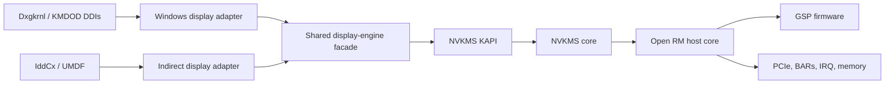

# Windows Display Driver Port Plan

## Feasibility

This is possible as a research project, but it is not primarily a WDDM
translation exercise. The critical path is porting enough of NVIDIA RM and its
GSP host support to Windows. NVKMS already provides most display-engine policy
and programming above RM.

The repository confirms:

- [README.md](README.md#kernel-interface-and-os-agnostic-components-of-kernel-modules)
  calls `src` OS-agnostic, but that means "separated from the Linux kernel
  interface," not directly Windows-buildable.
- [`src/nvidia`](src/nvidia) contains RM, GPU initialization, memory management,
  interrupts, firmware/GSP communication, and generated hardware code.
- [`src/nvidia-modeset`](src/nvidia-modeset) contains NVKMS: connector discovery,
  EDID, DP/HDMI, mode validation, display channels, surfaces, and flips.
- [`src/common`](src/common) contains the most readily portable timing, EDID,
  DisplayPort, HDMI packet, soft-float, and utility code.
- The rendering UMD is absent. The README explicitly requires matching
  proprietary userspace components, but a KMDOD does not need an NVIDIA
  rendering UMD.
- The published build selects 48 Unix-specific RM or NvPort files in
  [`src/nvidia/srcs.mk`](src/nvidia/srcs.mk). Only `common/` and `unix/` RM
  architecture implementations are present.
- Windows heritage remains visible, but
  [`cpuopsys.h`](src/common/sdk/nvidia/inc/cpuopsys.h) currently hard-codes
  `NVOS_IS_WINDOWS` to zero. This source snapshot was processed for a Unix
  release.
- NVKMS hardware operations funnel through `nvkms_call_rm()` and the RM
  object/control ABI in
  [`nvkms-rmapi-dgpu.c`](src/nvidia-modeset/src/nvkms-rmapi-dgpu.c). NVKMS
  cannot initialize hardware independently.

## Recommended Architecture

Multi-device support is a standing invariant. Driver-wide facilities such as
NvPort core state, memory tracking, thread registries, and OS process-notify
registration must be initialized once for the driver and torn down only at
driver unload. Per-GPU PCI, BAR, interrupt, RM, GSP, and display state must be
owned by the corresponding adapter instance. A driver-wide callback that needs
device behavior must dispatch through synchronized device-keyed subscribers;
one adapter must never replace or tear down another adapter's state.

Use the NVKMS KAPI, not the userspace-style NVKMS ioctl ABI. Linux DRM already
translates atomic display state into `NvKmsKapiRequestedModeSetConfig` and
calls `applyModeSetConfig()` in
[`nvidia-drm-modeset.c`](kernel-open/nvidia-drm/nvidia-drm-modeset.c). The KAPI
also exposes device allocation, connectors, memory, surfaces, modesets, and
events in [`nvkms-kapi.h`](src/nvidia-modeset/kapi/interface/nvkms-kapi.h).

## Staged Plan

### 1. Freeze a Narrow Hardware Target

Start with one non-boot, discrete Turing GPU, x64 Windows, one SST DP or HDMI
monitor, one head, SDR `X8R8G8B8`, no MST, DSC, audio, VRR, HDR, suspend, or
multi-GPU. Pin the source and GSP firmware to version `610.43.03`. This is only
the first hardware-validation configuration; mode enumeration, color, wire
format, and internal plane models must not hard-code these restrictions.

### 2. Create a Windows Portability Build

Create a Visual Studio solution with VC++ `.vcxproj` projects for `nvcommon`, a
dead-stripped RM core, NVKMS, the Windows platform layer, the diagnostic
driver, KMDOD, and IddCx components. Use the LLVM/Clang-CL platform toolset
with WDK headers, libraries, packaging, signing, and deployment integration.
Clang-CL is preferable initially because NVKMS still contains GNU attributes,
`typeof`, and inline assembly.

Keep this as a sidecar build under a new Windows-only directory. Projects must
reference NVIDIA sources in place; do not copy or rewrite them. Generate
project source lists and `.vcxproj.filters` from versioned Windows manifests,
and put compatibility definitions, forced includes, generated response files,
and platform implementations under the sidecar directory. Existing Makefiles,
`srcs.mk` files, generated headers/sources, and published source files remain
unchanged.

### 3. Inventory Unresolved Platform Symbols

Replace the Unix implementations selected by `srcs.mk` with a Windows platform
library. Cover allocation, locks, work queues, timers, PCI config, BAR mapping,
interrupts, DMA/IOMMU mappings, firmware loading, registry, logging, process
context, and cache/write-combine operations. Implement only symbols reachable
in the selected dGPU/display configuration.

### 4. Bring Up RM Before WDDM

Use a disposable test-signed diagnostic driver to prove, in order:

1. PCI identification.
2. Translated BAR resources.
3. BAR0 access.
4. Interrupt connection.
5. GPU reset.
6. GSP firmware boot.
7. RM enumerate/open/close.
8. VRAM allocation and CPU mapping.
9. Display RM controls such as connector enumeration, EDID/AUX, and hotplug.

Each item is a stop/go gate.

Current KMDOD and IddCx scaffolding cover the first four gates structurally,
but do not mark them as hardware-validated:

- PCI configuration identity is read through `DxgkCbReadDeviceSpace` and
  restricted to NVIDIA devices. The callback is retained behind a reusable,
  C-compatible platform contract that validates extended-config bounds and
  exact transfer lengths and supports later RM reads and writes.
- Translated memory and interrupt resources are retained as adapter-owned
  state, including large-memory descriptors and line/MSI metadata.
- PCI BAR0 is matched to its translated physical resource, rather than
  inferred from descriptor order. The complete translated aperture is mapped
  uncached through the reusable kernel platform library; checked reads collect
  `PMC_BOOT_0` and `PMC_BOOT_42`, and an all-ones response fails startup as a
  missing device.
- Dxgkrnl interrupt callbacks are registered and routed to the adapter, but
  the ISR intentionally returns `FALSE` until RM provides device-specific
  status and acknowledgement logic.

The IddCx path has now passed the original RM/GSP/NVKMS bring-up gate on an
RTX 4070 (`DEV_2786`) with an ASUS PG27U connected over DisplayPort. The
hardware-validated baseline maps BAR0 noncached and BAR2 write-combined.
It retains WDF pseudo addresses for framework access and
unmapping, while `WdfDeviceGetHardwareRegisterMappedAddress` supplies the real
process-visible mappings used by RM. BAR2 is a translated 32 MiB aperture at
`0x2FFE000000` in that bring-up snapshot. BAR1 was reported unassigned and is
not mapped by that baseline; large-memory descriptor filtering makes that
assignment report provisional (see the direct-VRAM copy investigation below).
The local source now decodes large-memory resources, resolves BAR identity
through corresponding raw/translated descriptors, and registers the full
64-bit BAR1 resource for bounded on-demand RM physical mappings. This hookup
is deployed and tested on the RTX 4070: the complete 16-GiB resource backs a
single shared sub-4-GiB CPU window. Warm restart initially required external
recovery; the subsequent bounded in-place reset/startup retry is now tested. See
the deployment assessment in the BAR1 implementation notes below.
The current staging/CE upload path does not need a CPU framebuffer mapping.
The INF must retain
`UmdfRegisterAccessMode=RegisterAccessUsingUserModeMapping`.

The first D0 transition creates one device-owned IddCx adapter and starts RM
and NVKMS asynchronously. Canonical `gpumgrStateInitGpu()` initialization,
GSP boot, NVKMS device allocation, RM GPU-device open, and clean teardown all
complete. NVKMS dGPU semaphore allocation retries in system memory when its
preferred video-memory allocation is unavailable; this is required on the
current UMDF path and is not evidence that every future scanout allocation
must use system memory.

The physical display snapshot is hardware-validated: seven connectors and
seven displays are discovered, one display is connected, its 384-byte EDID has
a zero checksum, and nine modes are exposed through IddCx. Windows receives a
successful `IddCxMonitorArrival` and selects a mode. The snapshot also reports
four heads, two layers on the selected head, and multi-layer capability.
`CommitModes2` now owns per-output state, allocates a pitched system-memory
`A8R8G8B8` gradient surface, selects distinct heads, and submits one atomic
full-device KAPI modeset. Hardware validation on the RTX 4070 reaches a
successful committing `NVKMS_IOCTL_SET_MODE`; visible-gradient confirmation is
still pending. The swap-chain worker remains blocked by D3D device setup with
`DXGI_ERROR_DRIVER_INTERNAL_ERROR` (`0x887A0026`).

The WDF interrupt object's ISR still returns `FALSE` and its DPC is empty.
GPU reset/FLR, interrupt acknowledgement, visible scanout confirmation, flip
completion, and runtime hotplug remain separate gates. Release and
partial-start failure already unwind the current objects in reverse order.

The root-enumerated development device bypasses PCI, MMIO, and interrupt
requirements so the software-only DDI lifecycle remains testable. GPU reset
and PCIe FLR remain recovery and repeated-test robustness gates, but no longer
block the validated RM/GSP/NVKMS startup path or the first static modeset. They
must be implemented through the RM/GSP lifecycle or the UMDF 2.35 bus-reset
contract, not as an ad hoc KMDOD register sequence.

Both driver alternatives use the same versioned NVIDIA common host ABI. KMDOD
owns one host context for the driver lifetime so every adapter shares the
singleton NvPort services without start/stop collisions; UMDF retains its
device-owned user-mode context. Kernel and UMDF providers implement allocation,
free, Unix-epoch and monotonic time, execution-context allocation safety, and
logging in their respective address spaces. The dual-mode common libraries
compile upstream status and SHA-256 code plus the host wrapper.

The first kernel NvPort slice is also active in KMDOD. It compiles upstream
NvPort sources unchanged where available, with sidecar Windows backends routed
through the common host context. Driver initialization binds NvPort before
Dxgkrnl can start any adapter, and driver unload shuts it down after adapter
teardown. This profile now enables core, atomic, CPU discovery, debug, memory,
pseudorandom generation, safe arithmetic, string, synchronization, thread,
time, and utility support. The upstream xorshift generator is suitable for RM
jitter and identifiers only; it is not a cryptographic entropy source.
The CPU sidecar provides CPUID and monotonic performance-counter time while
leaving privileged MSR, PMU, and integrated-memory-controller operations
explicitly unsupported until RM demonstrates a required, policy-safe use.
KMDOD also opens the service registry key once at driver initialization and
closes it at unload. Typed DWORD reads can address the root or relative subkeys,
giving global RM initialization shared immutable settings without attaching
registry lifetime to any GPU adapter.
The RM-facing query converts bounded ASCII parameter names without allocation
and imports DWORD values from the service `Parameters` subkey. RM writes remain
in its mutable in-memory registry rather than persisting runtime state back to
the Windows service configuration.
The first standalone RM OS-services library exports the upstream
`osReadRegistryDwordBase` hook and public `osReadRegistryDword` entry point with
`OBJGPU` opaque. A WDK-free C boundary maps Windows query results to
`NV_STATUS` without importing NT types.
The RM OS-services library exports `osGetSystemTime`, `osGetTimestamp`, and
`osGetTimestampFreq`. Wall time uses the Unix epoch expected by RM, while RM
timestamps and their frequency come from `KeQueryPerformanceCounter` so they
share the DirectX clock domain.
Monotonic and performance-counter helpers return nanoseconds. RM millisecond
delays yield at schedulable IRQL and use chunked processor stalls otherwise;
sub-millisecond delays always stall. Calls above `DISPATCH_LEVEL` retain the
upstream 20 ms hard-interrupt ceiling.
RM CPU discovery exports CPUID, base frequency in MHz when leaf `0x16` is
available, the possible logical CPU count across all Windows processor groups,
and a stable group-flattened current processor number for thread-state/TLS
indexing.
RM thread-state initialization exports maximum-core, current-thread,
current-process-flags, and scheduling hooks. System and terminating thread
state comes from WDK predicates; scheduler handoff uses a minimal relative wait
and returns an error at IRQLs where yielding is illegal.
The initial RM core library now compiles upstream `locks.c`, `locks_common.c`,
and `thread_state.c` unchanged under ClangCL. Its Windows-owned compatibility
surface is limited to the NvPort build profile, an `os_custom.h` overlay,
upstream include roots, and target-local exceptions for known generated-code
warnings.
The RM core graph now includes `system.c`, the direct RM API initialization
family, event logging, binary-data registration, and generated HAL registration.
Windows exports `osRmInitRm` to register all published HALs and configure the
standard thread-state policy while retaining registry ownership at driver scope.
The initial NVOC graph now compiles the runtime and generated system, base
object, traceable, HAL manager, HAL, and OS classes. The Windows `OBJOS`
initializer intentionally retains generated property defaults rather than
copying Unix reset, ACPI-cache, and vblank policy.
Link probing `coreInitializeRm` into KMDOD reaches `OBJSYS` construction and
HAL registration, then requires the complete versioned vGPU/GSP RPC module.
That module in turn pulls the resource server, memory descriptors, GPU NVOC
classes, GSP event infrastructure, process/page/DMA OS hooks, and diagnostics.
The resource server/client, memory descriptor/allocation, GPU/resource,
serialization, FINN timer, process/page OS-hook, logging, and HAL RPC portions
of that cohesive import now compile in the RM core library. Startup expansion
is proceeding in `sysChildObjects` order rather than adding arbitrary public
class descriptors: `OBJPFM` now includes its generated class, common platform
implementation, and upstream NBSI object/table owner. Do not link global RM
startup with placeholder RPC stubs or Unix control implementations merely to
satisfy the remaining linker surface.

`OBJHYPERVISOR` now follows `OBJPFM` with its generated class and all four
common backend operation tables. x64 hypervisor detection resolves through the
Windows CPUID export. ARM64 hypervisor detection obtains raw SMBIOS data through
`AuxKlibGetSystemFirmwareTable`; the platform validates and owns each returned
buffer until the matching `osPutSmbiosTable` call.

`OBJCL` now follows the existing Windows `OBJOS` child with its generated class,
common chipset implementation, PCIe topology/configuration owner, and chipset
information table. Both x64 and ARM64 compile the family unchanged. Keep
`pci_pbi.c` deferred until a concrete caller requires it; it is not part of the
constructor/destructor or current chipset selection path.

`OBJGPUMGR` was already complete in the RM core source graph. The following
`OBJGSYNCMGR` child now includes its generated class and common manager. Its
constructor installs the null provider for every G-Sync slot, so architecture-
specific device providers remain deferred until hardware discovery introduces
a concrete dependency.

`GpuAccounting` now includes its generated class and common implementation.
The constructor and destructor are closed by the existing intrusive map/list
containers and allocate no Windows-specific state. Timer sampling and process
telemetry remain inactive until later GPU startup paths call into the object.

`PlatformRequestHandler` now includes its generated class and both common
implementation owners. The sources reach shared generated client-resource
declarations, so their project items force-include `ctrl0000unix.h` using the
same declaration-only pattern as existing RM API sources. This exposes types
only and does not import Unix control implementations or policy.

`OBJRCDB` now includes its generated journal class and common robust-error
journal implementation. Its constructor allocates journal and diagnostic ring
storage through NvPort and uses existing RM time services. `journal.c` receives
the generated `nvrm_version.h` through target-local forced inclusion so upstream
version reporting remains unchanged.

`OBJVMM` was already complete in the RM core graph. `KernelVgpuMgr` now includes
its generated class, common profile helpers, kernel manager, and `eheap_old.c`,
which owns the manager's lazily-created vGPU ID heap. Constructor state remains
driver-global; per-GPU vGPU lists are initialized only when GPUs attach.

`OBJGPUBOOSTMGR` now includes both its generated manager class and the generated
`SyncGpuBoost` resource class owned by `gpu_boost_mgr.c`. The global constructor
is neutral; GPU IDs enter the existing btree-backed membership index only when
a client creates a synchronized boost group.

`Fabric` now includes its generated system class and common compute-fabric
implementation. Construction creates only driver-global list/multimap caches
and NvPort RW locks, leaving the node ID invalid. Fabric memory resources,
VASpaces, and GPU probing remain separate later dependencies.

The generated `GpuDb` class now pairs with the existing common GPU database
implementation. Its constructor creates an empty driver-global GPU list and
NvPort mutex; per-GPU records are still registered only during device startup.

A direct WDM `coreInitializeRm` link probe now drives link closure. Adding the
generated RM configuration utility removes all reachable `rmcfg_*` externals;
adding the shared `OBJENGSTATE` and `IntrService` generated/common family moves
the x64 Debug unresolved count from 853 to 832. The Windows provider and
filtered-composition work now closes the remaining graph: the probe rebuilds,
links, and signs with zero unresolved symbols in x64 and ARM64, Debug and
Release. Production KMDOD remains disconnected until the separate adapter
rundown and diagnostic interrupt activation gates are satisfied.

The generated `GpuManagementApi` class now pairs with its already-compiled
implementation. The generated/common `GSyncApi` resource layer also compiles
with its existing control handlers. Its reachable notification path exposes
`osEventNotification` and `osObjectEventNotification` as the next real Windows
OS-service boundary; no no-op event provider has been added.

The Windows event boundary now uses native dispatcher events. The platform
layer validates user handles against `ExEventObjectType`, retains and releases
object references, and signals with `KeSetEvent`. The RM sidecar implements
`osUserHandleToKernelPtr`, object reference counting, direct notifications,
extended callbacks, notification-index matching, and subdevice filtering. The
x64 Debug link probe moves from 831 to 825 unresolved externals.
Upstream `platform/cpu.c` now provides `RmInitCpuInfo` unchanged for x64 and
ARM64. Architecture-guarded Windows platform intrinsics provide the x64 CR4
and XCR0 reads used for OSXSAVE and AVX capability detection. ARM64 uses WDK
status-register intrinsics for MIDR and cache geometry; a platform spin lock is
held across each CSSELR/CCSIDR pair to prevent migration or competing selector
writes. Together with the public registry DWORD entry point, this closes CPU
discovery without placeholder cache values.
The Windows static-system provider queries `SystemPowerCapabilities` through
`ZwPowerInformation` and uses system-battery presence for the upstream notebook
criterion. Confidential-compute flags remain at their zero-initialized defaults
until Windows guest-isolation detection is implemented. This resolves
`osInitSystemStaticConfig` and moves the probe from 823 to 822.
The Windows `osBugCheckOnTimeoutEnabled` policy reads the optional service
`Parameters\BugCheckOnTimeout` DWORD through the driver-global registry
provider. Missing, invalid, and zero values disable the policy; nonzero enables
it. This moves the probe from 822 to 821.
Windows system callbacks now use caller-allocated `IO_WORKITEM` storage owned by
the driver object and queued with `IoQueueWorkItemEx`. Driver-global rundown
protection rejects work after teardown starts and drains accepted callbacks in
`osSyncWithRmDestroy`. This resolves that hook and `osQueueSystemWorkItem`,
moving the probe from 821 to 819.
The complete generated/upstream `MpsApi` pair closes its resource-catalog entry
without introducing new dependencies, moving the probe from 819 to 818.
The complete generated/upstream `KernelWatchdog` pair closes its catalog entry
without adding a unique dependency, moving the probe from 818 to 817. Its MIG
predicate remains part of the pending shared MIG manager closure.
The driver-global Windows RM semaphore implements blocking and conditional lock
acquisition without treating upstream's opaque allocation-free `pSema` as a
platform object, moving the probe from 817 to 814.
The complete upstream `Intr` owner and vector container resolve five shared
interrupt methods, while Windows GPU lock hooks implement hardware interrupt
masking through the `Intr` HAL. The newly visible FECS/GMMU/MIG/vGPU service
frontier is retained and the aggregate probe moves from 814 to 813.
An allocation-free, lock-protected platform PCI registry now owns stable
configuration handles keyed by complete BDF identity. The WDK-free RM sidecar
resolves all seven `osPci*` ABI functions, removing six reachable startup
externals and moving the probe from 813 to 807 without a single-adapter fallback.
The platform MMIO owner now tracks page-aligned Windows mappings behind RM's
direct virtual addresses and honors cached, uncached, write-combined, and access
protection modes. Four kernel/PCI map ABI functions move the probe from 807 to
803 without adding unresolved dependencies.
The unchanged upstream OS register and GPU mapping owners now route `OBJGPU`
accesses to BAR0, including vGPU PCI-mirror handling, over bounded Windows
register intrinsics. Complete NBSI and FNV owners plus native maximum-user-VA
policy move the probe from 803 to 797; Xid transport remains a separate owner.
Atomics use upstream Clang C11
implementations, debug strings route through the common host logger, and a
kernel platform contract owns opaque WDK spinlock, mutex, semaphore, and
reader/writer lock handles. NvPort also exposes global and dynamic paged and
nonpaged allocators over the host allocation contract. Formatted debug output,
memory tracking, and the remaining RM-reachable NvPort modules are the next
library gate before selecting the first RM sources needed for GPU reset and GSP
firmware boot.

### 5. Bring Up NVKMS/KAPI

Implement the Windows version of
[`nvidia-modeset-os-interface.h`](src/nvidia-modeset/os-interface/include/nvidia-modeset-os-interface.h):
allocation, timing, locking, timers, events, GPU enumeration/open/close, and
`nvkms_call_rm`. Prove `allocateDevice`, resource queries, connector/display
discovery, EDID, mode validation, and a headless allocate/free cycle.

Build a canonical, driver-internal display capability model rather than having
each Windows driver reinterpret EDID and NVKMS independently. For every GPU,
head, connector, and display, retain the complete NVKMS resource and layer
capabilities, connector conflicts, dynamic display state, EDID/DisplayID data,
physical dimensions, supported surface formats, LUT/scaler/rotation/composition
limits, and all candidate modes. Enumerate the full NVKMS mode pool until its
end marker, preserve exact timing and mode origin/preference, validate every
advertised mode, and rebuild the snapshot after display-change events. Do not
silently truncate refresh rates, detailed timings, interlaced modes, or modes
that are legal only with a particular wire encoding, BPC, dithering, or DSC
choice.

Represent wire capability separately from framebuffer format. A wire format
contains RGB, YCbCr 4:4:4, 4:2:2, or 4:2:0 encoding; BPC; color range;
colorimetry; EOTF; dithering; link bandwidth; and DSC state. Build the legal
mode/wire-format cross-product by intersecting sink data, NVKMS validation,
link bandwidth, GPU capabilities, and the applicable Windows driver contract.
Validate before advertising and again immediately before commit, then read
back or otherwise verify the selected wire state. Never report a combination
that NVKMS may silently replace with a different encoding or BPC.

The public NVKMS KAPI mode object exposes timings, HDR infoframes, output
colorimetry, LUTs, and dithering, but it does not expose explicit requested
wire encoding and BPC. Those controls and supported-output-color data exist in
the lower NVKMS mode-validation/set-mode interface. Add a narrow,
version-pinned Windows display-facade operation that validates and commits an
exact wire format through the existing lower interface while continuing to use
KAPI for device, memory, surface, layer, and event ownership. Keep this bridge
in the Windows sidecar and do not modify published NVKMS sources. Treat exact
4:2:0 selection as a stop/go check because the published interface expresses
it differently from RGB, 4:4:4, and 4:2:2; a preference is insufficient when
Windows committed a precise wire format.

The connector-scoped monitor-control transport is implemented in the shared
Windows display facade. It accepts bounded seven-bit I2C transmit, receive, and atomic
transmit-then-receive requests against a resolved adapter/connector/display,
not an arbitrary hardware port. Native HDMI/DVI/VGA use `NV40_I2C` and
`NV402C_CTRL_CMD_I2C_INDEXED`, resolving the connector's DDC port through
`NV0073_CTRL_CMD_SPECIFIC_GET_I2C_PORTID`. DisplayPort/USB-C requests use
`NV0073_CTRL_CMD_DP_AUXCH_CTRL` in I2C-over-AUX mode, with 16-byte chunks,
repeated-start/MOT handling, terminal data-chunk STOP, distinct
ACK/NACK/DEFER/timeout handling, and bounded write-status polling/retries.
Transmit and receive limits are 64 and 256 bytes. Native combined prefixes
are limited to four bytes; native length-prefixed receives return
`NOT_SUPPORTED` before bus traffic. Internal displays and DP MST are rejected.

The transport serializes conservatively through the existing global device
and recursive NVKMS locks shared with EDID, DP link training, hotplug, and
other NVKMS users; finer per-connector concurrency is deferred. Each request
checks connectivity and rejects adapter-local ports. Only DDC/CI address
`0x37` is allowed, excluding EDID, HDCP, and board endpoints regardless of
protected-content state. The IddCx boundary normalizes Windows' observed
directional `0x6E`/`0x6F` addresses and owns the WDF power/lifecycle reference
and NTSTATUS translation. The facade owns bus/device locking and RM
translation, with bounded lock waits and AUX software retries; synchronous
RM hardware calls retain RM's existing timeouts. KMDOD callback wiring is
still pending.

The initial Windows KAPI facade is now operational. It loads NVKMS, enumerates
and allocates the device, acquires modeset ownership, queries
connector/static/dynamic display state and EDID, enumerates modes, allocates
and maps pitch-linear `A8R8G8B8` scanout memory, creates KAPI surfaces, and
submits atomic full-device modesets. Device initialization also allocates the
NVKMS notifier, semaphore, and color-LUT support objects successfully. On the
RTX 4070, validation and the committing `NVKMS_IOCTL_SET_MODE` both succeed.
Modeset ownership must be released before device teardown.

Preserve the complete `NvKmsKapiDisplayMode` selected during enumeration for
commit. The current public Windows snapshot preserves the principal timing
fields but drops the mode name, horizontal skew, double-scan, and sync-polarity
flags. Reconstructing a mode from that reduced snapshot risks validating a
different mode. Extend the internal snapshot with the raw KAPI display handle
and mode, or keep an opaque generation-scoped selection token; invalidate it
whenever the connector generation changes.

NVKMS event-queue dispatch is already connected at the OS-interface boundary:
`nvkms_event_queue_changed()` calls `nvKmsKapiHandleEventQueueChange()` outside
the global KAPI lock. It remains inactive because device allocation supplies
no `privateData` or `eventCallback` and declares no event interest. Event
callbacks must only enqueue adapter-owned work; they must not call IDDCX, KAPI,
or RM directly while NVKMS is dispatching the callback.

### 6. Implement the Full KMDOD Mode Path

Register `KMDDOD_INITIALIZATION_DATA` through
`DxgkInitializeDisplayOnlyDriver`. Implement PnP/start-stop, child enumeration,
EDID/device descriptors, VidPn topology and cofunctional modality,
source/target modes, `CommitVidPn`, visibility, power, and
`DxgkDdiPresentDisplayOnly`.

Enumerate every connected target and all legal source/target mode pairings from
the canonical capability snapshot. Implement the two-call sizing contracts,
pinned-mode handling, topology validation, path transformations, monitor mode
recommendation, cofunctional modality pivot rules, active-path updates, and
transactional `CommitVidPn` rollback. Preserve exact rational refresh/timing
data and invalidate VidPn state on hotplug or EDID generation changes. Support
all topologies and clone combinations that the hardware/resource model reports
as simultaneously legal rather than assuming one permanent source and target.

KMDOD does not expose HDR, ACM, advanced color, or explicit wire-format control
through its current driver model. Advertise only the SDR framebuffer formats
and path capabilities that KMDOD can represent, but keep the internal mode,
head-color, wire-format, and plane objects identical to the IddCx path. Select
and record a validated SDR wire format internally; do not claim unsupported OS
controls and do not let KMDOD limitations collapse the shared abstraction.

Implement `DxgkDdiQueryInterface` and expose `DXGK_I2C_INTERFACE_2`, including
transmit, receive, and combined transmit/receive callbacks at `PASSIVE_LEVEL`.
Resolve `VidPnTargetId` through the current target-to-connector generation and
forward only validated monitor transactions to the shared display facade.
Reference/dereference callbacks must participate in adapter teardown so an
outstanding queried interface cannot use released connector or RM state.

### 7. Make Multi-Plane, Double-Buffered Scanout the Baseline

Define one internal present transaction for both drivers. It identifies the
adapter, head, target mode and wire format, and contains an ordered array of up
to `NVKMS_KAPI_LAYER_MAX` plane states plus cursor state. Each plane preserves
its surface format, source and destination rectangles, NVKMS layer index,
z-order, rotation/reflection, stretching, blending mode, constant alpha, color
key where supported, tearing/present interval, synchronization, input and
output transfer functions, input color space/range, HDR metadata, CSC matrix,
matrix overrides, and input/tone-mapping LUT state. Head state independently
preserves output colorimetry, HDR infoframe, output LUT, dithering, and wire
format. Keep OS-specific KMDOD and IddCx structures at adapters around this
model rather than embedding them in the display engine.

Both drivers own two pitch-linear scanout surfaces per active plane. Each
surface consists of an NVKMS `NVKMS_KAPI_ALLOCATION_TYPE_SCANOUT` memory object,
its CPU mapping, an `NvKmsKapiSurface`, pitch, dimensions, format, and explicit
lifetime state. Allocate all required pairs transactionally after the mode and
plane formats are known, initialize them to black, and destroy the old set only
after a replacement transaction and modeset are ready. Surface pairs belong to
the corresponding adapter, head, and layer; no global front/back indices are
allowed in a multi-device driver.

Track each slot as free, being copied, queued for flip, or front. A present may
write only free back slots. Submit one atomic NVKMS head transaction only after
all participating plane copies and input synchronization have completed, and
recycle each old front only after NVKMS reports the corresponding head/layer
flip. A property-only plane update uses the same validation and transaction
path. Mode changes, visibility changes, stop, power-down, and surprise removal
must cancel or drain copy work and flips before freeing any surface. Start with
exactly two surfaces per active plane; consider a third only if measurements
show that strict double buffering cannot absorb normal present cadence.

Initially copy the complete frame on every present. Alternating back buffers
means applying only dirty and move rectangles would leave unchanged regions
containing the frame from two presents ago. Dirty-rectangle optimization is
valid only after either copying the old front into the new back first or
accumulating every uncommitted frame's damage separately for each destination
slot. The current complete incoming surface supplies all accumulated regions;
old incoming surfaces do not need to be retained.

KMDOD initially creates one opaque primary plane because that is all its
display-only present contract supplies. IddCx initially does the same for one
swapchain frame. Neither front end may bypass the plane abstraction. If a
future IddCx contract exposes MPO, map each OS plane into this transaction and
NVKMS layer capability model; unsupported combinations can then be rejected or
composited without redesigning allocation, copy, color, or flip ownership.

### 8. Implement KMDOD CPU Copy and Flips

`CommitVidPn` allocates the surface pair and translates the complete VidPn state
into an NVKMS KAPI modeset. `DxgkDdiPresentDisplayOnly` validates the active
source, dimensions, format, source pitch, destination pitch, and arithmetic,
then copies each row from `DXGKARG_PRESENT_DISPLAYONLY::pSource` into the mapped
back surface. The initial path is synchronous and performs the full-frame CPU
copy before submitting an NVKMS configuration that flips to that surface.

The present path serializes against any pending flip so it never writes the
front or queued slot. NVKMS flip events and `getFlipPendingStatus()` drive the
front/back transition; vblank and display interrupts are acknowledged by RM,
routed through the KMDOD ISR/DPC, and used to notify progress without polling in
the steady state. Use bounded waits and fail or recover cleanly on timeout.
Add cursor, rotation, and dirty/move optimization only after single-head
modeset, continuous full-frame presents, unplug/replug, and teardown are
reliable.

### 9. Add a KMDOD DMA Copy Path

Add a per-adapter RM copy-engine channel with its own GPFIFO, USERD, notifier or
tracking semaphore, and synchronization. The KMDOD DMA feasibility gate is to
lock and describe the `pSource` system pages, map them into a GPU-visible RM
address space under the active Windows DMA/IOMMU policy, submit a pitch-aware
system-memory-to-VRAM copy, and observe its completion value. A raw physical
address or scatter/gather list must not be assumed to be a valid GPU address.

The `pSource` lifetime is guaranteed only for the present call, so the first DMA
implementation remains synchronous: retain its page/DMA mappings, submit the
copy, wait with a bounded timeout for the CE completion semaphore, then unmap
and unlock before returning. Queue the display flip only after CE completion
and the required CPU/device memory barriers. This removes CPU involvement from
the pixel transfer while retaining CPU command submission and completion
handling.

Support `Auto`, `Dma`, and `Cpu` copy policies through a development registry
setting. `Auto` prefers DMA only after the adapter passes a startup copy and
byte-verification test, otherwise it uses CPU copy. Any DMA error must quiesce
or reset the channel before a complete CPU copy overwrites the destination; an
incomplete DMA destination is never flipped. Record bytes, latency, fallback
reason, timeout, and reset counters for both paths.

#### Direct CPU Writes to VRAM Through a BAR Aperture

Investigated on 2026-10-05; this is a proposed optimization, not an implemented
or validated transfer path. The current IddCx `CopyFrame()` writes mapped NVKMS
system-memory staging. `NvKmsWindowsPresentLayersTimed()` then uses RM's copy
engine to upload that staging allocation into the separate VRAM allocation.
An acquired GPU texture can additionally require D3D11 readback staging before
that CPU copy. Mapping the destination VRAM would redirect that CPU copy into
VRAM, removing the NVKMS staging allocation and CE upload, but would not itself
remove source GPU readback.

Prefer allocation-aware RM mapping over arithmetic on PCI BAR addresses:

- `NvKmsKapiFunctionsTable::mapMemory()` already calls `nvRmApiMapMemory()` for
  the allocation's RM handle, offset, and size. Try this on the actual back
  surface's video-memory allocation with `NVKMS_KAPI_MAPPING_TYPE_USER`, not
  its system-memory staging allocation. RM must establish and retain whatever
  framebuffer-aperture translation the allocation requires; its
  `kbusMapFbApertureSingle()` path explicitly returns an aperture offset and
  length, not just the VRAM allocation's physical offset.
- This is not currently a drop-in switch: `osMapPciMemoryUser()` and
  `osMapPciMemoryAreaUser()` in `windows-open/rm/kernel/nvrm_os_gpu_mapping.c`
  return `NV_ERR_NOT_SUPPORTED`. Trace the allocation's actual mapping path,
  implement the applicable hooks with bounds/cache/ownership validation and
  balanced unmapping, and propagate failure rather than returning a pointer
  from a different address space or bypassing the user-mapping contract.
- The UMDF `NvPlatformRmMapPhysical()` implementation now accepts both eager
  registered apertures and bounded requests against assigned, registered
  demand-mapped resources. BAR1 uses the existing WDF ownership path,
  retaining both framework pseudo and process-visible addresses. Its complete
  physical size is independent of individual mappings; page-padded backing
  spans are limited to `0xFFFFF000` bytes, rounded down for the system page size.
  UMDF allows only one active mapping per assigned CM resource. The first
  request selects a bounded shared window; contained aliases are
  reference-counted and reused. An out-of-window request while leases remain
  returns `NV_ERR_STATE_IN_USE`; final unmap releases the window so a new one
  can be selected. Hardware release
  drains any remaining mappings after RM/NVKMS stop. Requests outside the BAR,
  beyond the per-map limit, or with conflicting cache policy fail explicitly.
- `PciBars` owns an indexed collection of uniform `PciBar` objects with an
  explicit policy table: BAR0 eager/noncached, BAR1 demand/write-combined,
  BAR2 eager/write-combined. These are RM memory-aperture indices, not PCI
  configuration DWORD positions. `ConfigSpace` discovers PCI addresses;
  `PciBar` resolves assigned resources and owns registrations/mappings, while
  `RegisterAperture` is a generic RAII WDF mapping/access backend.
  Nonmovable owners keep callback contexts stable, WIL handles unregister
  before smart-owned mappings are released, and one preparation scope guard
  preserves RM/NVKMS-before-BAR cleanup. Recovery suspends/restores demand
  providers without rebuilding fixed mappings or framework interrupt/DMA
  objects.
- BAR resource preparation and the RM attach builder use the same resolved,
  checked `CmResourceTypeMemory`/`CmResourceTypeMemoryLarge` metadata, including
  40/48/64-bit encoded lengths. PCI config addresses match raw descriptors;
  the corresponding translated descriptor supplies the mapped address and
  full 64-bit size. Missing, inconsistent, or ambiguous matches fail instead
  of selecting the next memory resource. BAR0/BAR2 remain eager mappings and
  register their actual translated bases; BAR1 is a write-combined demand
  provider wired into preparation, RM attach metadata, and teardown.
- Ownership-refactor validation additionally runs 333 checks against production
  `PciBar`/`PciBars` with mock config/WDF backends, including failure/destructor
  cleanup with live leases and demand-only recovery preserving fixed mappings.
  IddCx sources compile for ARM64; ARM64 linking/hardware remain untested.
  Reassessment of final signed x64 `oem199.inf` (2026-10-07) recovered GSP
  timeouts in both original startup hosts, kept the restarted host stable for
  60 seconds, preserved mode/layout and the AMD primary, and passed read-only
  DDC brightness/capabilities-string checks. The loaded DLL hash was verified;
  there were no new UMDF WER reports. The 12-second animation produced 374
  paints with 547 uploads/547 latches in ETW, not camera-verified frames.
- Local validation: over 200,000 resource/mapping checks and 8,000 concurrent
  map/unmap cycles pass against the production decoder/registry. Tests cover
  full 16-GiB resource metadata, high offsets, crossing 4-GiB boundaries,
  page-padded mapping limits, cache policy, reference counts, failure cleanup,
  resource isolation, exhaustion, teardown, and a backend enforcing the
  one-active-mapping rule. x64 IddCx/KMDOD builds and
  DDC/presentation regressions pass, as do ARM64 kernel/user platform library
  builds (not a full ARM64 driver or hardware test).
- RTX 4070 hardware assessment (2026-10-07): BAR1 is `0x2C00000000`,
  length `0x400000000` (16 GiB). An initial successful 64-KiB WDF map was
  followed by a verifier failure on a second mapping within that resource.
  The corrected shared-window driver (`oem193.inf`, DLL hash prefix
  `27E5BDFE`) maps `0xFFFFF000` bytes once and reuses aliases. Activation,
  desktop mode/layout, D3D12 pixel verification, CE uploads/latches, and DDC
  brightness 80 -> 105 -> 80 with exact restoration were tested. No new WER
  host/verifier reports occurred with the corrected build.
- Warm-restart testing released the window, but GSP returned
  `NV_ERR_TIMEOUT` (`0x65`) before a new BAR1 map; disable/enable recovered.
  A reset-only reproduction remained at Code 10 with no UMDF host/NVIDIA
  display for 60 seconds. This was a timeout, not `NV_ERR_RESET_REQUIRED`.
- The subsequent startup-recovery driver (`oem197.inf`, DLL hash prefix
  `BA95F22D`) uses advertised PCI function-level reset in place (`KeepStackReset`)
  and retries RM startup once after tearing down failed RM state/BAR1 leases.
  It retains WDF interrupts, the DMA enabler, and fixed BAR0/BAR2 mappings.
  Recreating the WDF interrupt within one preparation callback caused an
  experimental verifier failure; the corrected RM-only retry avoids it.
  Standard capabilities are `0x1`; bus-specific capabilities are `0x31`.
  No platform, secondary-bus, or power-controller reset is advertised/attempted.
  Three actual timeouts (activation and two restarts) recovered in the same
  startup host without external assistance. Each restart then retained a healthy
  host for 60 seconds, with no new WER host/verifier reports from the corrected
  candidate. Presentation, layout/mode, brightness 80 and DDC string retrieval
  pass after recovery. Reset/retry failures remain explicit and the retry is
  bounded; unsupported in-place reset retains the standard reset fallback,
  not an unverified in-process restart. See
  [PCI reset/startup recovery](windows-open/README.md#pci-reset-and-startup-recovery).
- The final driver is enabled with problem code 0 and verified presentation/DDC.
  Automatic startup recovery does not imply uninterrupted display output or
  recovery from arbitrary runtime hangs. High-offset hardware mappings, exact refresh/HDR
  comparison, and physical-panel output remain unvalidated. Baseline ETW has
  no frame events, so no before/after performance equivalence is claimed.
  No direct-copy change was made. Keep future allocation mappings alive across
  frames rather than introducing WDF map/unmap traffic per upload. See
  [BAR1 implementation notes](windows-open/README.md#bar1-resources-and-bounded-mappings).
- Earlier RTX 4070 evidence decoded BAR1 as `0x2800000000`, but the function's
  bring-up reported it unassigned while mapping BAR0 (16 MiB) and BAR2
  (32 MiB). The descriptor-filtering gap above makes that report inconclusive
  for large BARs. The working checkpoint's 2026-10-05 startup trace maps BAR2
  at `0x2BFE000000`, different from the earlier `0x2FFE000000`; addresses are
  not stable identifiers. Recheck complete current raw/translated resources
  before concluding that firmware/OS assignment blocks access. A PCI config
  address is not authorization to map unassigned physical memory.
- Do not assume `BAR1 base + VRAM allocation offset` is a valid CPU address.
  A bounded aperture can translate GPU pages and need not expose all VRAM
  linearly. BAR0 register space and the observed BAR2 aperture are not proven
  substitutes. Do not repoint aperture page tables behind RM's back or access
  ranges owned by another Windows driver. Investigate firmware/Resizable BAR
  and OS assignment only after reporting the actual aperture sizes and owner.

Keep direct mapping an optional capability with the current staging/CE path as
fallback. Use a pitch-linear, uncompressed surface, cover its full allocation,
and retain its RM mapping for exactly the surface and device-power lifetime.
Write-combined mappings need the correct store-drain/device-visibility barrier
before the flip; `FlushProcessWriteBuffers()` alone is not proof of a posted
PCIe-write drain. Resolve that contract in the platform/RM layer, avoid cached
aliases, and avoid read-modify-write or CPU reads from a write-combined mapping.
Never write the front or queued slot. Unmap before freeing or losing D0;
hotplug, modeset, reset, and removal must quiesce CPU writers. KAPI's mapping
contract also requires the caller to prevent GC6 while user mappings are used.

Validation gates:

1. Log PCI BAR identity/size, raw and translated resource ownership, cache
   policy, and RM allocation-map status. A successful pointer must resolve to
   the intended allocation, not an unrelated registered MMIO range.
2. Map a small scratch VRAM allocation; CPU-write asymmetric patterns, drain
   writes using the verified ordering contract, and use CE readback into
   system memory to verify bytes. Exercise unaligned offsets, page boundaries,
   aperture limits, and allocation relocation/lifetime without touching scanout.
3. Map both scanout slots and preserve the notifier-backed ownership
   state machine. Test BGRA8 and FP16 rows, differing pitches, HDR/SDR, cursor,
   CSC, continuous flips, modesets, unplug/replug, D0 exit, and reset/removal.
   A mapped VRAM destination must skip staging-to-VRAM upload; never copy stale
   staging over the pixels that were written directly.
4. Benchmark bytes and readback/CPU-copy/upload/total latency against staging
   plus CE on the same modes. CPU writes over PCIe may be slower than CE;
   fewer buffers do not establish an improvement. Consider
   `ID3D11Device3::ReadFromSubresource()` only as a separate source-readback
   experiment after verifying its DEFAULT-texture/`Map(nullptr)` contract and
   the destination's write semantics. It is not a peer-to-peer DMA API or a
   guarantee that a D3D driver can write safely into arbitrary device MMIO.

### 10. Prototype IddCx Independently

Build a virtual/sample-derived IDD that reports the same EDID and mode model,
creates an adapter and monitor, and owns a swapchain-processing worker. Then
bind it to the PCI device in a separate installation configuration; it cannot
coexist as function driver with KMDOD on the same PCI function. The IddCx branch
owns its own two NVKMS scanout surfaces and uses the same slot state machine and
flip-completion rules, but it does not share runtime objects with KMDOD.

The independent IddCx prototype has advanced through physical monitor arrival
and OS mode selection. Continue it through the following narrowly observable
gates before broadening color, DMA, or multi-monitor support:

1. **Power on with an internally generated surface.** This is implemented with
  a generation-scoped display/mode selection, one mapped gradient surface per
  output, distinct head assignment, and one atomic full-device request. Each
  active head attaches the exact enumerated mode and marks display, mode, and
  active state changed. Validation and commit both succeed on the RTX 4070.
  Physical inspection must still confirm that the sink displays the gradient.
2. **Flip one driver-generated static frame.** Allocate a second surface and
  submit a layer-only flip after the initial gradient is visibly stable. Add
  bounded completion using `getFlipPendingStatus()` first; then
  subscribe to `FLIP_OCCURRED` when the event path is enabled. This isolates
  scanout format, pitch, cache visibility, surface lifetime, and flip behavior
  from DXGI and IddCx buffer acquisition.
3. **Consume one IddCx frame.** Replace the current release-only worker with a
  retained-buffer transfer. Prefer the IddCx 1.10 system-buffer contract when
  available; otherwise copy the acquired D3D surface through an explicitly
  CPU-readable staging resource. Hold the acquired frame until the copy is
  complete, present the back surface, wait for bounded flip completion, call
  `IddCxSwapChainFinishedProcessingFrame`, and only then acquire the next
  frame. Keep two scanout surfaces before enabling continuous presentation.
4. **Add runtime connector reconciliation.** Supply KAPI `privateData` and an
  event callback, declare interest in `DPY_CHANGED` and
  `DYNAMIC_DPY_CONNECTED`, queue a device-owned worker, re-probe the complete
  snapshot, and compare display handle, connection state, EDID, and modes
  against the previous generation. On disconnect, stop the swap chain,
  disable the head, call `IddCxMonitorDeparture`, delete the monitor, and
  retire modes/surfaces only after in-flight work drains. On connect or EDID
  change, create a fresh generation and announce a monitor. Add bounded
  polling only as a diagnostic fallback if event delivery is not reliable.

The recommended next gate is black/static scanout, before dynamic hotplug. It
exercises the unproven hardware-critical path shared by every later feature:
exact mode commit, link training, head activation, surface visibility, and
power-down rollback. Dynamic hotplug is smaller in raw API surface, but doing
it first would immediately require teardown of modesets, surfaces, swap chains,
and pending flips that do not yet exist. Once a static frame is stable, add the
event subscription and disconnect handling before continuous frame processing;
that ordering forces the presentation lifetime to be hotplug-safe from its
first sustained implementation.

Implement the IddCx 1.10+ color and mode contract completely. Set
`IDDCX_ADAPTER_FLAGS_CAN_PROCESS_FP16`; report target WCG/HDR capabilities and
dithering in `EVT_IDD_CX_ADAPTER_QUERY_TARGET_INFO`; parse monitor modes and
enumerate target modes with the version-2 callbacks; include independent BPC
masks for RGB, YCbCr 4:4:4, 4:2:2, and 4:2:0; retain default HDR10 metadata; and
commit the OS-selected color space, encoding, and single BPC value through
`EVT_IDD_CX_ADAPTER_COMMIT_MODES2`. Derive these reports from the canonical
NVKMS/sink capability cross-product, including required bandwidth, rather than
from a fixed table. Support SDR sRGB, SDR WCG, and HDR10 mode transitions
without recreating unrelated adapter state.

Use `IddCxSwapChainReleaseAndAcquireBuffer2` with system-buffer acquisition as
the baseline frame contract so each frame carries its actual DXGI color space,
SDR white level, and default/unchanged/new HDR10 metadata. Accept and preserve
both 8-bit and FP16 swapchain surfaces. Allocate matching `X8R8G8B8` or linear
scRGB `R16G16B16A16` NVKMS scanout pairs as required, and configure each plane's
input transfer function, color space/range, CSC/matrix/LUT state plus the head's
output transfer function, colorimetry, HDR infoframe, dithering, and exact wire
format. A raw copy transfers pixels but does not by itself satisfy WCG/HDR;
NVKMS must perform the negotiated gamut and transfer-function processing and
send the correct signaling to the monitor.

Do not release/acquire the next frame until the current frame's CPU or DMA copy
has finished, because the acquired system-buffer mapping, color metadata, and
contents must remain valid for the entire transfer. CPU-copy the complete frame
into the matching mapped back surface, atomically queue its plane/head update,
and report frame statistics through IddCx. A Direct3D texture path is optional
later; it is not a prerequisite for the system-buffer path and must not assume
an unpublished NVIDIA rendering UMD.

Registered `EVT_IDD_CX_MONITOR_I2C_TRANSMIT`,
`EVT_IDD_CX_MONITOR_I2C_RECEIVE`, and
availability-gated `EVT_IDD_CX_MONITOR_I2C_TRANSMIT_AND_RECEIVE`. Each monitor
resolves to its adapter-owned display and the shared transport. Callbacks
retain a nonblocking WDF power reference, check D0/initialization state under
lifecycle protection, and publish receive data only after successful transfer
and cleanup. Monitor-control availability is retired after successful
departure or during reset/destruction, not on a failed departure that could
reuse the output. In-flight synchronous RM requests are lifetime-protected,
not asynchronously cancellable; forced removal/timeout certification remains
open.

#### ReadFromSubresource Experiment

Implemented and measured on 2026-10-05, retaining the existing NVKMS
system-memory staging-to-VRAM CE upload and notifier-backed double buffering.
`SwapChainD3D11::CopyFrame()` can use `ID3D11Device3::ReadFromSubresource()` to
write directly into `Output::BackPixels()` instead of mapping a D3D STAGING
texture and separately copying its rows into that destination. This is not
direct VRAM/BAR access or peer-to-peer DMA.

The API requires a CPU-readable DEFAULT texture previously mapped for READ
with a null mapped-subresource pointer. Check `D3D11_FEATURE_D3D11_OPTIONS2`
and `MapOnDefaultTextures`. The tested AMD-produced IddCx texture had no CPU
read access, so the working alternative first copies it into a reusable
CPU-readable DEFAULT texture, then maps, reads into NVKMS staging, and unmaps.
Direct reading from the acquired texture is supported when its creation flags
permit it; that path was not exercised on this host. Unsupported resources,
feature/API failures, and format conversion retain the original staging path.

Microsoft recommends 128-byte-aligned destination pointers and strides. Use
the least common multiple of 128 and NVKMS's required pitch alignment for both
staging and VRAM surfaces, retaining identical allocation sizes and CE copy
layout. The live 3840x2160 FP16 destination had pitch 30720 and pointer modulo
128 equal to zero. A whole-subresource read also meets the recommended
64/bytes-per-pixel horizontal and two-row vertical region alignment here.
No additional row padding was needed for this mode. References:

- https://learn.microsoft.com/en-us/windows/win32/api/d3d11_3/nf-d3d11_3-id3d11device3-readfromsubresource
- https://learn.microsoft.com/en-us/windows/win32/direct3d11/default-texture-mapping

The development DWORD `HKLM\SOFTWARE\NVIDIA Corporation\nv-iddcx\ReadbackMode`
is read when creating the swapchain D3D device: absent/0 preserves baseline,
1 prefers the alternative with fallback, and 2 alternates 120 texture-frame
blocks. Recreate the swapchain after changing it. Timing records distinguish
actual paths: 0 system buffer, 1 direct Map, 2 STAGING, 3 acquired DEFAULT
ReadFromSubresource, and 4 intermediate DEFAULT ReadFromSubresource. Requested
alternative frames that fall back are not alternative performance samples.
The first successful alternative and each alternative comparison block are
checked byte-for-byte against ordinary STAGING readback before CE upload;
verification frames are separately marked and excluded from timing analysis.
A mismatch restores the reference bytes and disables the alternative.

On TestFrame (AMD rendering, RTX 4070 scanout, 3840x2160 FP16 input / RGB10 HDR
output), package `oem180.inf`, DLL SHA-256
`845F934706B8BD2507BE930004666C47E41AE1C6A0178FEC1AE82980EA7635B6`, the
66,355,200-byte validation matched. Compare the same animated workload in the
initial alternative run and a subsequent restored-baseline run; the initial
baseline block mostly preceded animation and is not the table's baseline.
Exclude verification and the first five nonverification logged samples in
each animated interval. Baseline logging samples every 60 frames outside
startup; there are 17 baseline timing samples (13 accepted) versus 77
alternative samples (all accepted). These are descriptive measurements, not
a randomized repeated-block benchmark or a population drop-rate estimate.

| Stage | STAGING median / p95 (ms) | DEFAULT ReadFromSubresource median / p95 (ms) |
| --- | --- | --- |
| GPU copy enqueue/flush | 0.129 / 0.186 | 0.247 / 0.290 |
| Map | 1.991 / 2.409 | 1.603 / 1.808 |
| CPU destination transfer | 2.897 / 3.170 | 2034.307 / 2062.171 |
| Complete pre-CE transfer | 5.030 / 5.671 | 2036.225 / 2064.195 |
| CE upload, accepted frames | 18.144 / 18.199 | 87.795 / 87.842 |
| Total processing, accepted frames | 23.423 / 24.074 | 2124.279 / 2152.226 |

Pre-CE transfer includes texture creation, GPU copy enqueue/flush, Map, CPU
transfer, and Unmap; GPU completion wait is included in Map. The alternative
was approximately 405x slower for transfer and 91x slower for accepted-frame
processing. Frame-number/time deltas, not sampled-record counts, show about
29.55 processed texture frames/s for baseline versus 0.47 for the alternative.
CE code was unchanged, but its measured latency also increased; the cause of
that increase and the slow API destination writes has not been isolated.

Both measured traces decoded without lost events, unknowns, or format errors.
An attempted repeated motion run hit the previously observed warm GSP startup
failure before rendering and was excluded. The physical capture from that
failed startup showed no input, so it does not validate alternative scanout.
Recovery restored baseline mode and healthy GPU status; physical HDMI capture
then showed the animated workload, with all 28 adjacent sampled frames changing.
The test task and registry value were removed. Keep baseline as the default:
this host demonstrates no performance benefit from the alternative, despite
matching pixels and the recommended alignment. Do not infer results for the
untested direct-acquired-texture path, other memory cache policies, SDR, other
adapters, or BAR-mapped VRAM.

### 11. Gate and Implement Pure-UMDF DMA

The installed UMDF 2.35 function table exposes DMA enablers and common-buffer
allocation, but not DMA transactions or an API to pin an existing user buffer. The
current IddCx scaffold already creates a scatter/gather 64-bit
`WDFDMAENABLER` under `UmdfDirectHardwareAccess=AllowDirectHardwareAccessAndDma`.
Common-buffer-backed RM staging and synchronous CE uploads already work. That
does not provide a supported way to DMA-map an arbitrary D3D11 staging pointer.
The UMDF-only candidate instead imports the existing common-buffer allocation
into D3D12, so the rendering GPU can write the same RAM that CE already reads.

#### Native D3D12 common-buffer experiment

`windows-open/iddcx/swapchain_d3d12.cpp` implements native IddCx 1.11 D3D12
acquisition, with no D3D11 shared-resource bridge. The project targets 1.11 but
keeps its minimum IddCx version at 1.10; older runtimes retain D3D11. The OS
feature query is cached once, before adapter creation. D3D11 acquisition uses
runtime-compatible structure sizes.

Development DWORDs in the driver's framework-managed **Parameters** key.
Driver code opens it with `WdfDriverOpenParametersRegistryKey(WdfGetDriver(),
KEY_READ, ...)`, queries with `WdfRegistryQueryULong`, and closes with
`WdfRegistryClose`; it does not assume a driver name or hard-code the key path.

For UMDF on the test target, the framework key is under
`HKLM\SOFTWARE\Microsoft\Windows NT\CurrentVersion\WUDF\Services\nv-iddcx\Parameters`,
not the kernel Services tree. Package installation recreated/cleared this key
during testing: apply experiment values **after installation**, then restart and
verify the selected path in WPP. Registry values and the loaded DLL hash alone
do not prove that native swapchain processing ran. The pre-existing D3D11
`ReadbackMode` development key remains as a fallback when the framework-managed
`D3D11ReadbackMode` DWORD is absent.

Restart the device after changing these experimental values:

- `D3D12Mode` absent: native direct (mode 1); explicit 0: D3D11 baseline.
- `D3D12Mode=1`: GPU texture -> placed linear BUFFER in the WDF common buffer
  -> existing synchronous CE upload -> VRAM.
- `D3D12Mode=2`: D3D12 GPU readback BUFFER -> existing CPU row copy/conversion
  -> WDF common buffer -> CE. This is the same-API memcpy reference.
- `D3D12Mode=3`: alternate direct/reference blocks of 120 acquired frames.
- `D3D12Debug=1`: enable the D3D12 debug layer before device creation; report
  its warnings/errors in WPP. Missing debug support explicitly rejects native
  initialization rather than pretending validation ran.
- `SwapChainApi` absent/0: historical `D3D12Mode` selection; 11: force D3D11;
  12: force D3D12 (`D3D12Mode=0` then means native direct mode 1).
- `D3D11ReadbackMode` absent: legacy-key fallback; 0: ordinary Map/STAGING;
  1: ReadFromSubresource; 2: alternate 120-frame ordinary/ReadFromSubresource
  blocks. Unsupported ReadFromSubresource remains an explicitly logged fallback.
- `SurfaceCachePolicy` absent/0: honor RM's CPU cache request only for native
  pixel staging, and retain framework defaults for D3D11 pixels; 1: framework
  default for either API; 2: honor RM's request for pixels under either API.
  Native import can reject policy 1; a fallback is not a native-direct sample.
- `DirtyRects` absent/1: per-slot accumulated damage; explicit 0: original
  full-frame behavior. Enabling also requests precise IddCx present regions.
  Other values are rejected rather than silently treated as enabled.
- `RealtimeGpuPriority` absent/1: request source-GPU realtime scheduling.
  D3D11 uses the availability-checked `IddCxSetRealtimeGPUPriority` API on
  the actual bound `IDXGIDevice`. Native D3D12 requests a `GLOBAL_REALTIME`
  COPY queue after checking queue-priority support; unsupported or rejected
  requests are logged and retain a NORMAL queue. Its `IDXGIDevice` query is
  also logged; no unrelated D3D11 device or interface cast is used.
  Explicit 0 preserves ordinary GPU scheduling; other values are rejected.
- `MmcssDisplayPostProcessing` absent/1: each D3D11/D3D12 swap-chain worker
  calls `AvSetMmThreadCharacteristicsW(L"DisplayPostProcessing", ...)` from
  its own thread. Thread-local RAII calls `AvRevertMmThreadCharacteristics`
  on that same thread when processing exits. Registration/revert failures
  are explicitly logged; unavailable MMCSS does not disable display output.
  Explicit 0 preserves ordinary CPU scheduling. Invalid values/errors are
  logged without claiming registration succeeded. No system MMCSS task
  definitions are modified.

Native initialization failures log the HRESULT and use D3D11 on the same
swapchain. Runtime failures abandon that swapchain and select D3D11 on the next
assignment until baseline is reselected or the monitor is recreated. Never
interpret this fallback as a successful no-copy experiment.

Import requires that the common-buffer CPU pointer is the allocation base,
the entire owned extent is committed, and scanout pitch is D3D12's required
256-byte multiple. It does not import a larger private arena around an interior
D3D11 pointer. Scanout **staging** allocation sizes round up to 64 KiB for placed
BUFFER alignment; existing scanout pitch, VRAM allocation size, CE copy length,
and cursor allocations are unchanged. Import/placement/Map failures are explicit.
Incompatible pixel formats take the logged D3D12 CPU conversion path and are
labelled reference, not direct.

The first actual WDF import failed with `E_INVALIDARG`: D3D12 debug message 1088
requires writable memory **without PAGE_NOCACHE**. WDF's default common-buffer
policy on this target returned `PAGE_READWRITE | PAGE_NOCACHE`, even though the
RM allocator supplied a cache-type request. The DMA-provider interface now
passes that request through. The initial experiment applied it to allocations
after firmware initialization generally; the allocation-specific revision below
supersedes that broad policy. Only explicitly tagged pixel staging now uses
WDF's explicit `CacheType` when selected. Other allocations retain the original
framework default. Do not remove PAGE_NOCACHE
using VirtualProtect or create conflicting cache aliases. All direct/reference
comparisons must use the same explicit-cache allocation policy.

The acquisition call declares the actual COPY queue. Transfers use COMMON-state
implicit promotion/decay rather than assuming an opaque texture layout. A GPU
fence completes before Map/CPU access or CE. The destination remains mapped
through synchronous CE completion. Output quiesces the processor and releases
imported resources/heaps before freeing the WDF backing allocations, including
when disabling a mode. Cancellation does not invalidate in-flight source or
destination memory. Fence waits check device removal and log stalls; absent
completion/removal, teardown deliberately retains backing memory and can wait
indefinitely rather than cause a GPU use-after-free. This remains an experimental
path, not a production bounded-cancellation implementation.

The first direct frame for each back-buffer slot also copies to an independent
D3D12 readback buffer and compares **every active pixel byte**, both through Map
and through the original WDF pointer. Different virtual aliases are permitted
only if the original RAM has the correct bytes. Verification frames and the
first eight frames of each alternating block are excluded from cumulative
arithmetic averages. WPP records per-frame timings and per-path averages every
60 measured frames, including processed/accepted counts, GPU-completion wait,
CPU copy, directly timed pre-CE transfer, CE upload, total, and accepted-only
CE/total. The alternating reference also maps the imported common-buffer
resource for its CPU writes and supplies the written range to Unmap before CE
or subsequent GPU reuse; this matters on the target's non-cache-coherent UMA
device. Both slots are byte-reverified on each CPU-to-GPU block transition,
not just at startup. Do not infer FPS from
sampled event counts.

Ordinary VirtualAlloc/file-mapping imports were independently verified, but are
not evidence that WDF common-buffer import works. Actual explicit-cache WDF
imports subsequently succeeded: both 66,387,968-byte allocations imported at
their allocation base with `PAGE_READWRITE`, heap flags `0x421`, WRITE_BACK/L0.
Both 3840x2160 FP16 slots passed all 66,355,200 active bytes through Map and the
original common-buffer pointer. The native COPY queue completed under the
D3D12 debug layer. ShadowCast physical capture showed the animated test scene
(151 YDIF samples, mean 18.38, max 32.04) after the user corrected the physical
capture connection/window placement. Matched many-frame performance measurements
are recorded below.

##### Non-debug measurements and rollback (2026-10-05)

Final tested native package `oem184.inf`, DLL SHA-256
`184D288A3C741248B9364E3DBA4254BAAAFF51CB2E70FBEA0CF2B5E09EBEDF32`,
ran mode 3 with debug disabled, requested cache policy enabled, and a COPY
queue on the AMD UMA adapter (`CacheCoherentUMA=FALSE`). The manually positioned
120-second animation used the sole active NVIDIA screen; logical window bounds
were 2560x1440, while acquired textures and scanout were 3840x2160 FP16
(DXGI format 10, pitch 30720). Only HDMI through ShadowCast was physically
connected according to the user.

Analyze seconds 5 through 115 of each scene, excluding byte-verification frames
and the first eight acquired frames of every alternating block. The native
comparison contains 2,212 measured frames from one worker/head/format. Transfer
is directly timed before CE; completion wait is CPU-observed, not a GPU
timestamp. CE/total averages below include only frames accepted for upload.

| Path | Measured records | Accepted | Mean pre-CE transfer (ms) | Mean CPU copy (ms) | Mean accepted CE (ms) | Mean accepted total (ms) |
| --- | ---: | ---: | ---: | ---: | ---: | ---: |
| Native direct | 1,092 | 508 | 2.62 | 0.00 | 48.79 | 52.17 |
| Native readback + memcpy reference | 1,120 | 569 | 5.41 | 2.87 | 48.37 | 54.67 |
| Original D3D11 STAGING, sampled | 51 | 33 | 5.31 | 2.85 | 22.71 | 28.55 |

The direct path removed all measured CPU pixel copies and reduced mean
pre-CE transfer by 2.78 ms (51.5%) against the same-API reference. Accepted
total processing decreased by 2.50 ms (4.6%). Both common-buffer slots passed
all 66,355,200 active bytes repeatedly across CPU-to-GPU ownership transitions.
Physical capture showed the actual animation (201 YDIF samples, mean 18.49,
max 32.78). The native ETL, including matching old-package shutdown formats,
decoded with zero lost events, unknowns, or format errors; an old-host shutdown
failure and transient initial assignment failure preceded the measured interval,
which used the successful native worker without fallback.

##### D3D11 all-frame tracing

The sparse original-D3D11 records were caused by WPP in-flight recorder
filtering, not ETW loss. With the recorder enabled and
`ENABLE_WPP_TRACE_FILTERING_WITH_WPP_RECORDER` left at its default 0, the
recorder's default nonverbose filter also suppressed verbose ETW messages.
Requesting ETW level 5 alone therefore retained the periodic information-level
records. `trace.h` now enables independent ETW filtering while retaining the
recorder, and parenthesizes the trace-level macro argument so conditional
levels and disabled flags are handled correctly. Information-level sessions
retain startup/every-60-frame sampling; verbose sessions collect every frame.

D3D11 now directly times the complete `CopyFrame` call before CE and records
head, input dimensions, and DXGI format per frame. This timer includes resource
creation, copy enqueue/flush, blocking Map/GPU completion, CPU row copy,
and Unmap, rather than estimating the interval by summing stage fields.
It excludes idle acquisition waits, the frame-state lock, and CE/presentation;
system-buffer production/completion before acquisition is not a separately
measured GPU wait. Native D3D12 similarly includes its explicit fence wait.
Neither measurement is a GPU timestamp or CPU-utilization measurement.

Group every measured frame by actual path, worker, head, dimensions, and format,
and report accepted and dropped records separately. Paths 0 (system buffer)
and 1 (direct texture Map) still perform the CPU row copy; path 2 uses a STAGING
texture before that copy. Do not interpret an absent faster path as disabled
when the OS supplies only GPU-only DEFAULT textures. Check acquisition's
`systemMemory` result and source usage/CPU-access flags, not just a requested
mode. Validate consecutive frame numbers and zero event loss before claiming
an all-frame population.

The follow-up used the tracing-corrected build (DLL SHA-256
`A35E2C5C1F07468E27B9D2D235A47F05A6F541E0555A4256A616B9857B37B726`)
in D3D11 mode 0, with `honorRequested=0`: original WDF cache policy, no D3D12
processing or ReadFromSubresource experiment. The installed package reused
the now-free `oem181.inf` name; package identity was verified by hash rather
than assuming that OEM numbers never repeat.

A five-minute run of the same manually positioned animation was analyzed from
seconds 5 through 295. It yielded **8,287 consecutive frames**, numbers
684 through 8970, all from one worker/head at 3840x2160 FP16 (format 10).
There were 7,286 accepted uploads and 1,001 pending-flip drops; dropped frames
still performed the source transfer. No verification or alternate-path records
were mixed into these averages. ETW decoded with zero lost events, unknowns,
or format errors. ShadowCast showed the actual animation (201 YDIF samples,
mean 18.78, max 32.92).

| Metric | Population | Mean (ms) | Median (ms) | p95 (ms) |
| --- | ---: | ---: | ---: | ---: |
| Pre-CE transfer, directly timed | 8,287 | 5.393 | 5.340 | 6.359 |
| Map, including GPU completion wait | 8,287 | 2.434 | 2.420 | 2.925 |
| CPU row copy | 8,287 | 2.787 | 2.724 | 3.376 |
| CE upload, accepted | 7,286 | 19.571 | 18.162 | 18.269 |
| Total processing, accepted | 7,286 | 25.232 | 23.746 | 25.645 |

Every animated frame was STAGING path 2. There were no system-buffer path 0
or direct-Map path 1 frames, and every CPU row-copy duration was at least
2.382 ms. Acquisition reported `systemMemory=0`; the source was a DEFAULT
texture with CPU access flags zero. This demonstrates the actual path used
by this workload, not that faster acquisition paths are unavailable for all
other swapchains. The subsequent 60-second post-scene desktop interval produced
only one acquired frame, also path 2: transfer 5.57 ms, CPU copy 3.05 ms,
CE 87.89 ms. Mostly no frames were produced, rather than a different low-copy
processing path. One idle frame is not a performance population.

The larger population supersedes the 51-record descriptive sample for D3D11
performance conclusions. Rare CE spikes (maximum 94.233 ms) raised the mean
above the 18.162 ms median; no cause was isolated. These remain wall-clock
processing timings, not CPU utilization. The original `oem180.inf` package
and its hash were restored afterward; D3D11 remained the active/default path
at that checkpoint.
Per-frame stage histograms are retained as a standalone offline HTML report
with measured/all-captured/validation-only scopes, accepted/dropped filters,
full-tail and percentile-range views, and CSV export. The native direct interval
contains 20 validation frames and 60 additional warm-up frames excluded from
its 1,092 measured records; reference excludes 80 warm-up frames from its
1,120 measured records. Thus the default direct histograms do not include the
extra verification copy, while the validation-only view exposes its timing.

The original `oem180.inf` baseline was restored and independently tested with
the same scene, geometry, and FP16 format. Its original trace still sampled
every 60 frames despite requesting ETW level 5; the 51 records are descriptive
sample averages, not an all-frame population or FPS estimate. Its pre-CE
figure sums enqueue/flush, Map (including completion wait), CPU copy, creation,
and Unmap timing fields rather than a direct transfer timer. Its ETL also
decoded with zero lost events, unknowns, or format errors. Physical baseline
motion was verified separately (201 YDIF samples, mean 18.62, max 29.65).

At this earlier checkpoint, the experimental native path was **not yet an
overall performance win over the
original baseline**: CE latency is substantially higher in both native paths.
The API/import and cache-policy changes differ from baseline; the cause has
not been isolated. Requested cache policy currently applies to post-firmware
common-buffer allocations generally, not just scanout staging. The subsequent
allocation-specific experiment below resolves that scope. Native direct with
accumulated damage is now the default; D3D11 remains an explicit override and
compatibility fallback.

Rollback removed only the hash-verified session packages `oem181.inf` through
`oem184.inf` and restored both registry value journals. The original loaded
DLL hash was verified as
`845F934706B8BD2507BE930004666C47E41AE1C6A0178FEC1AE82980EA7635B6`,
device status OK/problem 0. One recovery restart resolved the known
pre-swapchain warm GSP startup failure; no reboot was needed. The exported
baseline, candidate archives, matching trace formats, and measurements are
retained for reproducibility. No commits or pushes were made.
Final verification at 22:34 PDT confirmed the original loaded hash, healthy
device, both experiment DWORDs absent from both journaled keys, and all four
session packages removed. The owned scene task was unregistered and its
temporary workload files removed; the owned ETW logger was stopped.

### Cursor programming independent of CE uploads (October 8)

Full-frame uploads previously held the same exclusive device lock as hardware
cursor programming. Cursor moves also made a redundant RM resource query that
could wait behind synchronous CE work. The Windows backend now uses shared
device-lifetime protection, separate serialized CE transfers, short display
programming/notifier exclusion, and complete-present transaction serialization.
Uploads release display-programming exclusion; cursor position-only programming
does not take CE exclusion. Hot paths use immutable KAPI topology fields.
Lifecycle/modeset operations remain exclusive, and cursor image uploads still
share the cached CE channel.

Production-header concurrency tests pass 24,054 checks, including cursor/flip
exclusion, actual cursor work while a copy guard remains held, CE/presenter
serialization, moved guard ownership, and teardown waiting for active shared
work. Existing damage, ownership, parameter, DDC/AUX/I2C, and BAR regressions
pass, as does the signed x64 build.

Deployed package `oem200.inf` (DLL SHA-256
`8BA7FC24C991FCF2C526AE0742A098BDD6FD04EC11513C4FF2EB16B0A112333C`) passed
initialization and warm restart. After a transient desktop/monitor enumeration
change, the AMD primary and baseline layout returned without this session
changing settings. A coordinated AMD session separately reported its own
AMD-only install/rollback; the transient is not attributed to the NVIDIA patch.
Read-only brightness 80 and MCCS string retrieval pass.

The user's 60-second reproduction provides real concurrency evidence: the
58.668-second analysis interval contains 589 complete 66,355,200-byte FP16
uploads and 2,554 successful position-only cursor attempts. **759 cursor
programming intervals are wholly inside complete-frame upload intervals**.
Cursor lock-wait p95 is 1.1 microseconds, total backend cursor median/p95 is
0.0699/0.2094 ms, and full-frame upload median/p95 is 18.2555/18.3834 ms.
No cursor failures/retries or ETW loss/decoding errors were recorded.
Automated GDI-window runs did not sustain hardware-cursor updates and are not
accepted cursor-overlap evidence. This is backend timing/concurrency validation,
not a camera measurement, physical input-latency claim, or matched before/after
smoothness benchmark. See
[synchronization details](windows-open/README.md#hardware-cursor-and-frame-upload-synchronization).

### Allocation-specific pixel cache and accumulated damage (October 6)

The completed native IddCx checkpoint was committed as `5f12929a`; no push.
The later cache/damage work is separate. Pixel cache provenance uses a dedicated
NVKMS allocation type, the existing RM allocation `tag`, a Windows-only memory
descriptor flag, and a typed purpose passed to the WDF DMA callback. It does not
use a device-global or thread-local scope, allocation-size guessing, or a new
wire ABI. Both KAPI interface-header copies stay synchronized. Cursor, firmware,
channel, semaphore, notifier, and other ordinary allocations keep their original
WDF policy.

The cache-only build was hash `A1CFBF98AE52D5DE651487E91D953C9BC7501B033713DE06567E6CCEABBB5315`.
Each cached-pixel run logged exactly two tagged allocations of 66,387,968 bytes,
requested cache 0 / WDF cache 1 (MmCached). Native imports and full comparisons
of all 66,355,200 active bytes passed for both slots. The following measurements
use the same 120-second full-screen animation, its +5 through +115 second steady
window, accepted frames, and the existing warm-up/verification exclusions:

| Path / pixel policy | Measured | Accepted | Mean CE ms | Median CE ms | p95 CE ms |
|---|---:|---:|---:|---:|---:|
| D3D12 direct / pixel-only RM request | 1344 | 692 | 29.136 | 18.237 | 67.275 |
| D3D12 reference / pixel-only RM request | 1366 | 814 | 23.615 | 18.182 | 44.070 |
| D3D11 STAGING / RM request | 3085 | 2532 | 21.247 | 18.166 | 44.046 |
| D3D11 STAGING / framework default | 3143 | 2364 | 22.194 | 18.177 | 44.069 |

All three ETLs decode with zero lost events, unknowns, or format errors. These
fresh D3D11 controls do **not** show a pixel-cache slowdown. Restoring ordinary
allocations' baseline policy reduced the native direct median from approximately
48.75 to 18.24 ms, while cached pixels remained necessary for import. This
strongly implicates the previous broad cache-policy change, but does not identify
the particular command/notifier allocation responsible. Means still contain
long-tail stalls; do not claim that native direct is an overall win.

The shared dirty-region tracker supports arbitrary buffer counts. Each slot
starts full-dirty; every acquired frame's damage accumulates into every slot,
and only successful presentation clears the selected slot. Dropped uploads
do not commit damage. Copies always read the current complete incoming image.
Resize resets all slots. Metadata discontinuities, unsupported move regions,
excessive counts, and ambiguous empty metadata trigger logged full refreshes;
retrieval or malformed-rectangle errors fail explicitly.

The current transport representation is deliberately conservative: at most two
sorted, non-overlapping **full-width horizontal bands**, merging the smaller gap
when a third band would be needed. The existing synchronous CE utility exposes
linear ranges, not pitched 2D copies. Bands bound each upload to two RM control
calls rather than one per partial-width row; RM can still internally chunk DMA.
Narrow vertical damage can therefore overcopy substantially. Exact narrow 2D
regions would require a separate pitched-copy transport design.

D3D11 GPU copies, direct Map/STAGING, ReadFromSubresource, system-buffer CPU
conversion, and D3D12 direct/reference paths all consume the shared region plan.
Native direct validates the first partial update of each slot and periodically
recompares the entire image against an independent full readback when damage is
enabled. Verification frames are identified and excluded from timing populations.
Tracing reports actual uploaded bytes and linear-region counts. D3D11 uses a
separate frame-keyed upload event: adding both fields to its already long timing
event exceeded TracePDB's decoding-metadata limit. Existing timing fields remain
unchanged, and the validated runs decode with no unknown events.

Standalone boundary/coalescing/resize tests and 100,000 modeled frames across
1/2/3/7/17 slots pass, including random damage, arbitrary slot selection, dropped
uploads, independent RAM/VRAM, and complete-image equality after accepted copies.
Run `windows-open\iddcx\tests\run-dirty-regions-tests.ps1` with Visual C++, UMDF
headers, and the project's restored WIL package installed. The runner accepts
`WdfIncludePath` and `WilIncludePath` overrides for the parameter tests.
The integrated Debug driver builds, catalogs, and signs successfully.

Hardware sparse-damage tests used two moving rectangles over a static grid,
with explicit old/new-location invalidation rather than a full-window repaint.
All rows below are accepted, non-verification uploads inside each scene's steady
window. The D3D11 control and damage run are matched 60-second runs; native
direct/reference alternate in a 90-second run:

| Sparse-scene path | Accepted | Mean upload bytes | Mean CE ms | Median CE ms | p95 CE ms | Maximum regions |
|---|---:|---:|---:|---:|---:|---:|
| D3D11 full-frame control | 800 | 66,355,200 | 25.651 | 18.187 | 44.066 | 1 |
| D3D11 accumulated damage | 911 | 9,000,960 | 12.275 | 12.317 | 12.402 | 2 |
| D3D12 direct accumulated damage | 939 | 9,000,960 | 12.304 | 12.316 | 12.411 | 2 |
| D3D12 reference accumulated damage | 898 | 9,000,960 | 12.313 | 12.322 | 12.445 | 2 |

Every accepted damage upload in these populations was partial, with no
steady-scene full-refresh fallback. The matched D3D11 run reduced payload by
86.4%, mean CE time by 52.1%, and median CE time by 32.3%. Band expansion,
linear-control-call overhead, and completion observation remain relevant;
these measurements do not establish proportional bandwidth scaling or identify
the remaining approximately 12 ms floor. Native full-image comparisons passed
repeatedly for both slots after partial writes. ShadowCast physical captures
showed the intact static background and moving rectangles without stale trails.

A separate full-frame native animation regression used `SwapChainApi=12`,
`D3D12Mode=0`, and `DirtyRects=0`, confirming forced native-direct selection:
708 accepted uploads of all 66,355,200 bytes, median CE approximately 18.23 ms.
Sparse mode selection also verified that API 11 overrides a nonzero D3D12 mode.

The ReadFromSubresource sub-mode test caught and fixed a verification-specific
bug: a partially updated CPU-readable DEFAULT intermediate was incorrectly
used as a complete reference. Verification frames now snapshot the full
current incoming surface before releasing it; partial CPU extraction still
uses the accumulated region plan. A fresh 90-second alternate-mode run passed
three complete 66,355,200-byte comparisons and physical output validation.
Its steady populations included 247 actual DEFAULT/ReadFromSubresource path-4
uploads and 168 ordinary STAGING uploads, all partial and at most two regions.
ReadFromSubresource remains unsuitable for performance: mean pixel-copy time
was approximately 276.25 ms versus approximately 0.33 ms for ordinary sparse
CPU copying. It remains registry-selectable, not the default.

The final repaired build's SHA-256 is
`E1ED6494D511FE422166C2ED6AB0B4BF5A0E1F1E37DF6BDBE08C7733E8E92433`.
Cache/damage changes and the subsequent default-policy revision are committed
together; unrelated worktree changes were preserved. Rollback identity-checked
and removed only this session's four
experimental packages, restored original `oem180.inf` / hash
`845F934706B8BD2507BE930004666C47E41AE1C6A0178FEC1AE82980EA7635B6`,
and freshly verified loaded-module identity, device OK/problem 0, and the
physical desktop. All six journaled experiment DWORDs returned to absent.
Both owned ETW loggers were stopped and the owned scene task was unregistered.
No reboot or push was needed.

The default-policy revision selects native D3D12 direct common-buffer copying
and accumulated damage with no registry settings. Automatic pixel-cache policy
therefore selects the import-compatible cache policy only for pixel staging;
ordinary allocations remain unchanged. Explicit `D3D12Mode=0` or
`SwapChainApi=11` retains D3D11, and `DirtyRects=0` retains full-frame copying.
Reference/alternating modes remain opt-in, and native API/import/runtime
failure handling still provides the existing logged D3D11 fallback.
The parameter tests cover missing keys/values even when a failed query changes
the output, every valid API/mode combination, explicit dirty disable, invalid
values, and registry access/type errors. This revision was built and tested
locally; it does not deploy or restart the restored target.

Default-policy deployment exposed a framework missing-key status not returned
by the earlier explicit-setting experiments: UMDF can return
`STATUS_NO_SUCH_FILE` when the Parameters key itself is absent. It is treated
as absence alongside name/path-not-found, so no registry key or explicit
experiment values are required. The regression tests cover this status even
when the failed query changes the output. Other registry errors still propagate.

The corrected default-policy build was deployed and **left installed** on the
target as `oem181.inf`, DLL SHA-256
`DF20D23E2FCCBEB8FB9FC2934A28C0E1F32D4C41281087133559A789C3779251`.
Loaded-module identity and device OK/problem 0 were freshly verified, with all
six experiment DWORDs absent. Native direct path 5 and accumulated damage were
confirmed in runtime traces without explicit selection values. A 60-second
sparse-scene test yielded 884 accepted steady-window uploads, all partial,
9,000,960 bytes each, at most two regions, mean CE 12.305 ms / median 12.310 ms.
Both slots passed repeated complete-image verification: 18 passes, including
16 after partial updates. Only two allocations carried cached-pixel provenance.
The ETL decoded with zero losses, unknowns, or format errors. ShadowCast
confirmed the intact animated scene and final desktop. The validation task and
owned loggers were removed; no rollback, reboot, or registry override remains
after this successful deployment. The original exported package is retained.

#### Source GPU priority and MMCSS experiment (2026-10-06)

Both source-device paths now support the independently configurable scheduling
requests described above. The D3D11 source device accepted
`IddCxSetRealtimeGPUPriority` with `S_OK`. Native D3D12 returned
`E_NOINTERFACE` (`0x80004002`) when queried for `IDXGIDevice`, so the IddCx API
was not invoked with an incompatible pointer. The native COPY engine advertised
GLOBAL_REALTIME support, but actual queue creation returned
`DXGI_ERROR_ACCESS_DENIED` (`0x887A002B`). A NORMAL queue was then created and
its actual descriptor priority was verified as 0. No privilege, system task,
source-device bridging, or adapter-wide scheduling settings were changed.

`AvSetMmThreadCharacteristicsW(L"DisplayPostProcessing", ...)` succeeded on
the actual D3D11 and native D3D12 swap-chain worker threads. Teardown traces
also verified successful `AvRevertMmThreadCharacteristics` calls on those same
threads. The target already had the DisplayPostProcessing task configured
with High scheduling category; no task definition needed modification.

Ten matched 60-second sparse-scene runs used the same signed DLL and the
same +5 through +55 second steady window, excluding warm-up and image-check
frames. There were 14,250 measured frames and 12,011 accepted uploads.
Every accepted upload transferred 9,000,960 bytes in at most two regions.
Transfer means below include source GPU completion waiting and use all
measured frames; CE and total means use accepted uploads only.

| Source path / requests | Measured | Accepted | Mean transfer ms | Mean CE ms | Median CE ms | Mean accepted total ms |
| --- | ---: | ---: | ---: | ---: | ---: | ---: |
| D3D12, both off | 1377 | 958 | 0.926 | 12.308 | 12.315 | 13.465 |
| D3D12, GPU request only (denied) | 1388 | 1175 | 0.906 | 12.289 | 12.303 | 13.406 |
| D3D12, MMCSS only | 1388 | 1360 | 0.918 | 12.273 | 12.293 | 13.397 |
| D3D12, MMCSS + denied GPU request | 1394 | 1388 | 0.939 | 12.252 | 12.288 | 13.407 |
| D3D11, both off | 1491 | 1341 | 1.643 | 12.258 | 12.293 | 14.144 |
| D3D11, realtime GPU only | 1486 | 1458 | 1.618 | 12.295 | 12.317 | 14.142 |
| D3D11, MMCSS only | 1484 | 1108 | 1.634 | 12.259 | 12.307 | 14.164 |
| D3D11, realtime GPU + MMCSS | 1479 | 1350 | 1.648 | 12.294 | 12.309 | 14.170 |
| D3D12, both off (repeat) | 1381 | 1024 | 0.946 | 12.252 | 12.293 | 13.440 |
| D3D12, default MMCSS + denied GPU request (repeat) | 1382 | 849 | 0.914 | 12.261 | 12.295 | 13.405 |

The approximately 12.3 ms CE floor did not materially improve. Native GPU-wait
means remained 0.765-0.802 ms; D3D11 transfer means remained 1.618-1.648 ms.
An initially promising reduction in dropped uploads did not reproduce:
native combined-request acceptance changed from 1388/1394 to 849/1382.
Therefore these runs do not establish a consistent drop-rate/throughput
benefit. They verify successful MMCSS registration and D3D11 realtime
authorization, not a realtime native queue or an intrinsic DMA-speed gain.
This was the existing sparse workload, not a source-GPU contention stress test.

The new scheduling build was left installed as `oem182.inf`, loaded DLL
SHA-256 `D127DC63587B71A53A92C3C00EEE80CA4C615CDC9B87D8AF65EE4E76C08DE027`.
Fresh final verification showed problem 0 and all eight experiment DWORDs
absent: native direct path 5, accumulated damage, MMCSS registration enabled,
and the explicitly logged NORMAL-queue fallback. The final default run passed
18 full 66,355,200-byte image comparisons, including 16 after partial updates
and both destination slots. All ten ETLs decoded without losses, unknowns,
or format errors; ShadowCast confirmed both API paths and the final desktop.
The owned scene task and logger were removed. The previous working DF20
native-default package was exported and hash-verified before replacement and
remains available for rollback. Focused policy/model tests and the signed
Debug build/catalog passed. The scheduling implementation and measurement
record are committed; no push was performed.

#### Pipelined scanout, VRR preference, and non-tearing immediate flips

This IddCx optimization targets sustained 60+ FPS where the source and
physical display can supply that rate. Before this work, the path serialized
source readback and synchronous CE upload, used two paired buffers, requested
`minPresentInterval=1`, and discarded new frames while a flip was pending.
It did not activate per-flip VRR. The implementation and measured outcome
below supersede the initial two-buffer/no-VRR bring-up restrictions for
IddCx only; KMDOD behavior is preserved.

**Policy and desired defaults**

Use the framework-managed UMDF Parameters key and the existing strict DWORD
reader, including missing-key defaults and explicit malformed-value errors.
Keep independently selectable controls for matched tests and rollback:

| Parameter | Values | Desired default |
| --- | --- | --- |
| `VrrPreference` | 0: disabled; 1: prefer VRR when supported by the GPU, sink, link, and selected mode | 1 |
| `FlipMode` | 0: existing synchronized/non-tearing mode; 1: non-tearing immediate/latest-ready presentation | 1 |
| `FramePipeline` | 0: existing serialized processing; 1: overlapped source-copy and CE-upload workers | 1 |
| `ScanoutBufferCount` | 2: baseline; 3: triple buffering; 4: bounded experiment if three slots still cause ownership stalls | 3 |

Report requested and effective policies separately. Unsupported VRR or
immediate-flip capabilities must have an explicit, reason-coded synchronized
fallback; neither fallback may enable tearing. Desired defaults become
shipping defaults only after their safety and hardware validation gates pass.
Keep D3D12 direct common-buffer copying and dirty regions as the preferred
copy path, and retain D3D11/reference-mode controls.

**1. Establish flip semantics and completion evidence first**

- Follow NVKMS interval/tearing fields through the target display-class
  programming. Determine whether interval zero with tearing disabled permits
  pending non-tearing updates to be superseded, and how notifiers identify
  latched versus skipped updates. Do not equate interval zero, API acceptance,
  or `CommitPresent()` with actual scanout or safe buffer retirement.
- Add frame/submission identifiers, slot identifiers, copy-fence values,
  requested/effective VRR and flip policies, and notifier/latch timestamps.
  Separate source acquisition, GPU copy, CPU extraction, CE, flip submission,
  pending wait, and physical retirement. Distinguish every drop/replacement
  reason and measure queue depth and frame age, not just accepted uploads.
- If the available interface cannot prove pending replacement and retirement,
  retain synchronized ownership until that mechanism is established. Never
  use a synchronization-bypass operation as an unverified replacement shortcut.

**2. Replace the front/back toggle with explicit buffer ownership**

- Start with three VRAM scanout slots. Track uploading, ready, queued,
  scanning, and reusable states using actual completion evidence. A successful
  submission alone must not recycle either the previous front or a queued
  candidate. Correlate stale/late notifications with submission generations.
- Track common-buffer RAM leases separately from VRAM display leases, even
  if allocations remain paired initially. GPU writes and CE reads of the same
  RAM slot cannot overlap; CE writes cannot touch scanning or still-queued
  VRAM. RAM can be released after CE completion independently of scanout.
- Triple buffering is a starting configuration, not proof of zero bubbles:
  scanning, pending, uploading, and source-copying may need four independent
  roles. Measure stalls; decouple RAM/VRAM pools or use the bounded fourth
  slot rather than recycling an in-use allocation.
- Make all Output accessors, native imported heaps, source readbacks,
  verification resources, damage tracking, mode transactions, and teardown
  honor the configured count. Preserve pixel-only cached allocation provenance.

**3. Pipeline source readback and CE without extra CPU copies**

- Use a single source-device/IddCx producer and a bounded upload/presentation
  consumer. Source GPU copy of frame N+1 must be able to execute while the
  existing synchronous RM CE call reads frame N's different common buffer.
  This does not require an asynchronous CE ABI or a kernel companion.
- Keep D3D12 command allocators/lists and fence values valid until GPU
  completion; do not reset in-flight command storage. Keep each imported
  resource mapped and its RAM lease pinned through its CE completion.
  Attach timing, damage, HDR/color metadata, mode generation, and resource
  ownership to immutable frame jobs rather than mutable per-worker fields.
- Respect the IddCx acquired-surface ownership contract: finish the source
  copy before releasing/notifying completion for that surface. D3D11 immediate
  context use remains confined to the source worker. The consumer must not
  concurrently Map/Unmap that context's resources.
- Split VRAM upload from flip submission: a free third VRAM slot can be
  uploaded while another flip is pending. Replace the blanket pending-flip
  rejection with destination-specific ownership checks, not unconditional
  permission to overwrite the current front.
- Audit the global NVKMS device lock and Output locks. Do not hold an output
  state lock while waiting for a worker that needs it, and do not assume
  independent threads overlap if their allocation/query calls serialize
  behind the CE lock. Use events/condition variables rather than busy spinning.
- Bound queue depth and backpressure. Supersede only unconsumed ready work;
  never discard or recycle a GPU/CE-active job. Preserve accumulated damage
  when coalescing frames and preserve source metadata with the chosen image.

**4. Preserve complete-image correctness under concurrency**

- Every producer snapshot must represent its complete incoming image. Start
  with full source-GPU copies if necessary, without adding a CPU memcpy to
  native direct mode. Optimize source dirty bands only after per-RAM-slot
  history guarantees that any later-selected VRAM destination can be repaired
  entirely from that snapshot.
- Track RAM and VRAM content generations independently. Damage ingestion for
  N+1 can run before upload N completes, so the current unconditional
  `Commit(slot)` cannot clear future damage. Use generation-aware plans and
  commits, or equivalent separate in-flight/future accumulators.
- Successful CE updates establish VRAM content even if that image is not
  displayed; a canceled flip is not a canceled completed copy. Partial-copy
  failures invalidate the destination. Discontinuities, history limits, moves,
  and ambiguous metadata retain conservative full-refresh behavior.
- Test two, three, and four slots, producer-ahead schedules, delayed fences,
  failed copies, skipped/replaced frames, and late flip notifications using
  complete-image RAM/VRAM model comparisons. Never clear damage for a frame
  that was not copied, or read future pixels from a reused source slot.

**5. Enable VRR preference and non-tearing immediate presentation**

- Obtain physical VRR capability from NVKMS dynamic display information,
  validate the selected mode/range/link, and refresh it on mode change or
  hotplug. Pass the effective preference through modeset and per-flip
  `vrrEnabled`/`allowVrr`; do not infer capability from a registry preference.
- Implement `FlipMode=1` using the proven non-tearing interval/present-mode
  mechanism. Without VRR, latest-ready replacement still obeys vblank; with
  VRR, refresh may begin earlier only within the sink's valid timing range.
  Neither case allows a mid-scanout tearing flip.
- Recycle superseded pending slots only after hardware proves they cannot
  latch or read those allocations. Preserve atomic color/HDR/layer state and
  ordered completion semantics. A fourth buffer cannot substitute for this
  proof, and VRR does not inherently remove all pending-flip restrictions.

**6. Validate and enable defaults incrementally**

- Land testable policy/ownership changes, then triple buffering, then source/CE
  overlap under synchronized flips, then VRR and immediate presentation.
  Keep serial/two-buffer/fixed-refresh/synchronized controls throughout.
  Validate D3D11 and all native sub-modes, SDR/HDR/FP16, hotplug, mode changes,
  stop/restart, fence/CE failures, and drain-before-free teardown.
- Run repeated matched controls separating pipelining, buffer count, VRR,
  and flip policy. Use a source actually producing at least 60 distinct FPS
  and a display mode supporting the required rate. After warm-up, measure
  at least 120 seconds per population; target sustained 60 displayed FPS,
  with no full one-second interval below 60 when source/sink are above 60 Hz,
  bounded queue/frame age, and no unexplained losses or pixel mismatches.
  For a 60 Hz mode, use its exact nominal rate as the ceiling rather than
  claiming more than 60 physically displayed frames.
- Prove overlap with timestamps/fences and verify actual latch/retirement,
  not merely CPU-thread concurrency or submission FPS. Report CE bytes,
  regions, stage distributions, frame age, effective policy, and all losses.
  Full-image checks must cover every slot after partial and skipped updates.
- Use ShadowCast for image/tear checks, but its current 30 FPS capture is not
  proof of 60+ displayed FPS or VRR. Use hardware flip timestamps and, for VRR,
  a compatible physical sink plus link/refresh evidence. If capture hardware
  does not support VRR, explicitly validate the fixed-refresh fallback.
- Preserve the currently deployed D127 package for rollback before deployment.
  Verify loaded DLL hash, device problem 0, actual paths/policies, image
  comparisons, and physical output. Enable the desired defaults only after
  those gates pass; document any unsupported hardware policy honestly.

Pipelining changes the throughput bound from approximately the sum of source
and CE times toward their maximum; it does not make the CE transfer itself
faster. The measured sparse-frame CE floor of about 12.3 ms can permit roughly
81 uploads/s in isolation. Full 4K FP16 frames are 66,355,200 bytes and measured
best-case full-frame CE near 18 ms already limits that workload below 60 FPS.
If that bound persists, payload/bandwidth or CE submission optimizations are a
separate requirement; VRR and additional buffers cannot overcome it.

**Implemented design and defaults (October 6)**

All four policy controls above are implemented, with the desired defaults
enabled. They are read from
`HKLM\SOFTWARE\Microsoft\Windows NT\CurrentVersion\WUDF\Services\nv-iddcx\Parameters`.
Missing values use defaults; malformed DWORDs and query failures other than
missing-key/value statuses fail explicitly. Existing API, native-mode,
D3D11 readback, cache, damage, and scheduling controls remain available.

- [swapchain_pipeline.cpp](windows-open/iddcx/swapchain_pipeline.cpp) provides
  one IddCx/source-GPU producer and one synchronous CE/presentation consumer
  for both APIs. Native mode 1 retains the direct imported-common-buffer path
  with no additional transport pixel memcpy. D3D12 command storage is reused
  only after the source fence completes. D3D11 context operations remain on
  the producer, and source-surface ownership lasts through completed GPU
  reads and CPU extraction.
- [frame_slots.hpp](windows-open/iddcx/frame_slots.hpp) tracks RAM and VRAM
  independently, even though their allocations remain paired. CE can read
  RAM slot A into free VRAM slot B. RAM becomes reusable after CE and Unmap;
  queued/scanning VRAM stays protected until ordered notifier retirement.
  All imports, damage histories, allocations, and verification resources
  honor two, three, or four slots.
- The producer makes a complete-current-image RAM snapshot using its own
  accumulated damage. The consumer separately accumulates VRAM damage and
  commits a destination only after a successful upload. Immediate mode may
  coalesce completed, unconsumed RAM jobs; their damage is retained before
  releasing their mappings/leases. GPU/CE-active jobs and submitted VRAM are
  never coalesced. Consumer jobs are local copies, including their color
  transform, because RAM job storage may be overwritten after CE releases
  its lease.
- `FlipMode=1` requests `minPresentInterval=0` with `tearing=FALSE`; it does
  not use the backend hardware tearing `_IMMEDIATE` mode. At most two
  protected submissions are outstanding, matching the KAPI notifier ring.
  The latest ordered notifier must have begun with a valid timestamp before
  older fronts/candidates are retired; stale acknowledgements cannot retire
  a newer submission. `queuedPrior>0` proves an outstanding protected update,
  not that a previous image was never physically displayed.
- Startup and pending-flip drain/retirement have two-second bounds. Fatal CE
  or flip failures mark scanout as requiring a new modeset, preventing API
  fallback from reusing uncertain storage. Adapter teardown joins workers
  before replacing mode/head/geometry.
- VRR activation is gated by dynamic physical capability and the preference;
  rejected VRR-permitted mode validation retries fixed refresh explicitly.
  Existing G-SYNC/Adaptive-Sync modeset negotiation was already enabled:
  this work adds initial/per-flip activation permission. Preference zero
  prevents activation, not necessarily every link-level negotiation.
  Actual per-flip `vrrFlip` is reported separately.
- Healthy-device `DXGI_ERROR_ACCESS_LOST` retires an invalid native swapchain
  without setting sticky D3D11 fallback. Repeated mode-change trials observed
  these invalidations followed by new native workers, with API 12 throughout
  the measured native populations. Genuine device/pipeline failures retain
  failure handling; stop-time `E_PENDING` is not treated as native failure.

**Final-candidate hardware evidence**

The signed Debug/catalog candidate is installed as `oem185.inf`, loaded DLL
SHA-256 `D9B02FFF9C6B139A874CFE6156117254D9C9F9C08CA511CE38CDF20513B8039F`.
Each trace was decoded with its matching preserved PDB/TMFs, with zero event
loss, format errors, or unknowns. The collector enforces the actual source API
and uses the reported QPC frequency. Its overlap count requires a source GPU
enqueue-to-successful-fence/Map-completion bracket wholly inside an earlier,
different frame's nonzero CE call. These are host-side completion brackets,
not independently calibrated GPU-engine timestamps.

The moving-band source painted approximately 105 times/s. The temporary
accepted mode was 1920x1080 at approximately 59.94 Hz; Windows reports integer
frequency 59. These HDR trials used FP16 source pixels and 10-bpc output.
Measured windows exclude five seconds at each end of the clip:

| Configuration | Measured s | Uploads | Uploads/s | Observed latch records/s | Mean CE ms | Contained GPU overlaps |
| --- | ---: | ---: | ---: | ---: | ---: | ---: |
| Native direct, pipeline/immediate, three slots (defaults) | 120 | 7,080 | 59.00 | 57.60 | 4.29 | 108 |
| Same native defaults, repeated | 60 | 3,547 | 59.12 | 57.02 | 4.29 | 57 |
| Native direct, serial/synchronized, two slots, VRR off | 120 | 5,959 | 49.66 | 49.65 | 5.77 | 0 |
| D3D11 normal staging, pipeline/immediate, three slots | 60 | 3,538 | 58.97 | 57.37 | 4.02 | 62 |
| Native direct, pipeline/immediate, four slots | 30 | 1,784 | 59.47 | 57.00 | 4.14 | 5 |
| Native mode 2 reference readback, three slots | 30 | 1,763 | 58.77 | 57.17 | 4.39 | 36 |
| Native mode 3 reference path, three slots | 30 | 1,764 | 58.80 | 56.27 | 3.93 | 53 |
| D3D11 ReadFromSubresource mode 1, three slots | 30 | 241 | 8.03 | 8.03 | 5.88 | 109 |
| D3D11 ReadFromSubresource mode 2, three slots | 30 | 431 | 14.37 | 14.23 | 5.15 | 94 |
| Native defaults, original 3840x2160 ~29.97-Hz mode | 30 | 887 | 29.57 | 29.57 | 12.23 | 0 |

The combined native defaults improve upload throughput about 19% versus the
serial/synchronized/two-slot control. This comparison does not isolate the
pipeline from the changed buffering and flip policy. Different accumulated
damage/payload populations also mean the CE averages are not a matched
bandwidth comparison. Four slots did not establish a meaningful latch-rate
advantage in the short trial, so three remains the default.

The first native-default run averaged 3.25 MB per CE upload, with median CE
4.38 ms and p95 4.64 ms. Its source-completion-to-flip-submission interval
averaged 4.63 ms (maximum 39.52 ms), compared with 14.09 ms (maximum 49.37 ms)
for the serial control. This interval is not input-to-photon latency.
There were 6,911 unique hardware latch timestamps among 6,912 observed latch
records. The observer can miss intermediate flips, so neither uploads nor
observed records certify the exact number of physically displayed images.
The two native-default clips passed 77 and 47 complete RAM-image comparisons,
including partial updates and all three slots. The four-slot native clip
passed 33, and the final 4K default clip passed 15. Ownership/damage model
tests additionally compare complete modeled RAM/VRAM images. ShadowCast
showed the intact grid and moving regions on the final native candidate and
correct desktop output after restoration; its 30-FPS capture is image
evidence, not a 60-FPS/VRR certification.

The experimental D3D11 ReadFromSubresource modes remain selectable and pass
their readback comparisons, but source extraction averaged 121.84 and
59.51 ms in these clips. They are not the preferred path. Their performance
must not be confused with D3D11 normal staging or native direct copying.

**Limits and final target state**

- The sink reports VRR unsupported; all observed `vrrFlip` values were zero.
  Fixed-refresh operation and preference zero were tested. Positive VRR,
  range behavior, and link evidence still require a compatible physical sink.
- The original mode is approximately 29.97 Hz. The accepted temporary mode
  is approximately 59.94 Hz; Windows rejected 1080p120 with
  `DISP_CHANGE_BADMODE` before applying it. Neither mode can certify 60+
  distinct displayed frames/s.
- The first native population's minimum complete wall-clock second had 41
  uploads, and the repeat's had 46. The target of no one-second dips below
  nominal refresh is therefore not achieved. The implementation proves
  overlap and improves this workload, not guaranteed sustained 60+ FPS.
- Reference/four-slot trials were short correctness/performance checks, not
  120-second certification populations. SDR/BGRA8 transitions, physical
  hot-unplug during pending work, and injected hardware failure/drain cases
  were not newly certified in this matrix. The conservative models cover
  delayed/coalesced/stale-notifier schedules, but do not substitute for those
  hardware tests.

Focused strict-policy/damage/ownership tests passed: 100,000 original damage
frames plus 900,000 ownership/deferred/independent/coalescing schedules.
The signed IddCx Debug build/catalog and KMDOD compatibility build/catalog
passed. The implementation remains pure UMDF without a transport companion.
The D127 rollback and the replaced independent candidate were separately
exported and hash-verified. Final fresh verification showed problem 0, the
loaded D9 DLL, all twelve experiment DWORDs absent exactly as in the original
journal, and the original 3840x2160 mode retained. The owned scene task was
removed and its ETW logger stopped. The presentation implementation and
validation record are committed together; no push was performed.

If pure UMDF cannot bridge WDF's DMA mapping to an RM/GPU-visible address, keep
the CPU path fully functional and choose explicitly between shipping without
DMA or using an uncertified experimental KMDF transport companion. Microsoft
describes IDD as a user-mode model without kernel-mode components, so a helper
changes the product and certification story.

### 11a. Live Parameters, Internal MPO Demos, and a Control App

**Status: implemented; demo-Off live switching verified, atomic MPO activation
still failing, October 11, 2026.** Release x64 build/signing, ARM64 compile
checks, and local configuration, presentation-ownership, pattern, and backend
request tests passed. The NativeAOT control app passed local tests and launch checks from
the synchronized Desktop folder. Target testing now verifies normal desktop
presentation and live source-API switching, but not visible MPO effects.
Normal desktop presentation remains the default; do not enable demos on the
tested RTX 4070 until the atomic activation failure is resolved.

The goal is to demonstrate display-engine features that the current IddCx
frame contract does not expose, using driver-generated surfaces alongside
the OS desktop. This is **internal NVKMS multi-layer composition**, not Windows
DWM MPO support: do not advertise new IddCx capabilities or describe generated
planes as OS-supplied windows.

#### Pre-Implementation Building Blocks and Capability Gates

- [Driver parameters](windows-open/iddcx/driver_parameters.hpp) already
  validate several DWORDs, but readers are spread across output, damage, and
  source-API initialization. D3D11 also retains a legacy `ReadbackMode` key.
  Settings do not currently share an immutable, watched configuration.
- Both source APIs feed
  [SwapChainUploadPipeline](windows-open/iddcx/swapchain_pipeline.hpp), which
  also supports serialized processing. It currently submits exactly one
  layer and retires desktop buffers using primary-layer flip observations.
- [The Windows NVKMS interface](windows-open/modeset/nvkms_windows.h) already
  accepts an array of layers, crop/destination rectangles, opacity, and CSC.
  Its current gamma handling is a **head output LUT**, not an independent
  overlay LUT. Rotation, explicit blending modes, and per-layer LUTs need
  additional wrapper plumbing and validation.
- Recorded RTX 4070 resources reported **two layers on the selected head**:
  the desktop plus **one** overlay. This is historical capability evidence,
  not a fresh HDMI/head check. Query the actual assigned head, layer formats,
  rotation/reflection mask, composition modes, and LUT caps at runtime.
  KAPI's maximum array size is not the number of available hardware planes.
- Unsupported modes or parameter combinations must be reported as such.
  Never silently pre-compose into the desktop, pre-rotate pixels, or apply a
  head-wide LUT and call that successful independent-plane hardware support.

#### Uniform Driver Parameters and Valid-Configuration Reconfiguration

Introduce one driver-owned `DriverParameters` class with typed configuration
snapshots and small per-output subscriptions. Reuse the existing strict
readers/tests; source implementations consume a snapshot instead of querying
the registry independently during initialization or frame processing.

1. Own the framework Parameters key, notification event, stop event, and
   watcher lifetime with RAII. Use `WdfDriverOpenParametersRegistryKey` with
   `KEY_READ` and obtain its borrowed UMDF `HKEY` through
   `WdfRegistryWdmGetHandle`; the native handle must not be separately closed.
   Arm asynchronous `RegNotifyChangeKeyValue` for value changes, rearm before
   rereading, and reconcile changes arriving during snapshot construction.
   Handle missing/deleted/recreated keys and notification errors explicitly;
   stop/join callbacks before closing the key or destroying subscribers.
2. Centralize existing names, defaults, ranges, and precedence:
   `SwapChainApi`, `D3D12Mode`, `D3D11ReadbackMode`, `SurfaceCachePolicy`,
   `DirtyRects`, `D3D12Debug`, `RealtimeGpuPriority`,
   `MmcssDisplayPostProcessing`, `VrrPreference`, `FlipMode`,
   `FramePipeline`, and `ScanoutBufferCount`. Preserve current defaults and
   the legacy D3D11-key precedence while it remains supported; watch that key
   too, but do not introduce another configuration store.
3. Validate the **whole candidate**: types, ranges, cross-field requirements,
   target output, current mode/format, and requested demo capabilities.
   Missing ordinary values retain their documented defaults; invalid values
   and access errors are not absence. An invalid runtime candidate leaves the
   last valid configuration and running swapchains untouched, with a precise
   rejection reason. Report requested, accepted, and effective settings
   separately, including existing reason-coded source-API fallbacks.
4. Add an optional `ConfigRevision` DWORD for grouped edits. The GUI writes
   an odd in-progress revision, all values, then the next even revision last.
   Accept only a stable even revision read before and after the snapshot.
   A crashed writer leaving an odd revision must not interrupt the running
   configuration; expose it as an incomplete update, not success. Serialize
   GUI writers, reject revision exhaustion, and provide an explicit recovery
   action. With no marker, debounced/stable RegEdit changes remain supported
   as individual edits; these are not advertised as atomic multi-value edits.
5. Compare normalized effective configuration, not raw registry events.
   Duplicate notifications, inactive-API-only edits, and equivalent defaults
   must not recreate anything. Coalesce rapid changes into the newest valid
   generation, and do not repeatedly retry a rejected generation.
6. For an affected output, queue normal-lifecycle work that asks its worker to
   stop, drains source GPU/CE/presentation work, and deletes the IddCx
   swapchain through the existing framework lifecycle. Never delete or join
   from the source worker or under a lock that the worker needs. Hold proper
   WDF references while work is pending and cancel it on removal/cleanup.
   IddCx's next assignment consumes the accepted snapshot; record both the
   requested generation and successful application generation.
7. Distinguish `Reconfigured`, `RuntimeFailure`, and `Removed` teardown.
   Intentional deletion must not set the D3D12-failed latch or accidentally
   force D3D11. A new valid native configuration can request a bounded fresh
   attempt; actual native failure keeps its existing explicit fallback.
   Reconfiguration must also rebuild configuration-dependent scanout pools
   and imported heaps: merely deleting a worker is insufficient for cache
   policy or buffer-count changes. Preserve current cursor/copy concurrency.
8. Stage replacement resources before publishing applied state. Allocation,
   import, or test-commit failure reports rejection and restores the previous
   working generation without an unbounded recreate loop. Monitor hotplug,
   modeset, power transitions, and a newer generation invalidate stale work.
   At cold start, retain an explicit, logged safe-baseline/error policy rather
   than inventing a previously accepted configuration.

An initial target is one reconfiguration per committed effective generation,
without device disable/enable, driver reinstall, or a monitor
departure/arrival. Log the request-to-reassignment interval and verify that
IddCx actually recreates the swapchain; do not assume a restart is invisible
or guarantee no brief frozen frame.

#### Shared Presentation and Demo-Surface Ownership

Extract a small common present coordinator around the existing upload
pipeline. D3D11 and D3D12 remain source-frame producers; neither owns a demo
implementation or calls a separate experimental flip path. Demo mode `Off`
uses the same single-plane path and must preserve current behavior/performance.

- A present transaction contains the latest desktop plane plus zero or more
  demo planes, their immutable property/LUT states, configuration/mode
  generation, and surface leases. Upload all changed pixels before one atomic
  head commit; property-only updates retain the previous completed content.
- Software-render small, deterministic animated patterns into CPU-accessible
  NVKMS scanout allocations, then use the existing CE upload path. Start with
  approximately 384x256 or 512x320 sources and two buffers per demo plane.
  Bound bytes and cadence; a demo timer defaults to 30 Hz and supports 15/60
  Hz only within the selected display's limits. No per-tick allocations.
- Give each plane independent free/uploading/queued/scanning ownership.
  Primary-only flip completion cannot retire an overlay surface or LUT.
  Extend completion tracking to every changed layer, including superseded
  presents and disabled planes, before reuse/free. Keep all resource leases
  alive until retirement; a successful submit is not a retirement fence.
- Continue animation while the desktop is static: the coordinator waits on
  desktop jobs, a waitable demo timer, completion, and stop events. Reuse the
  current desktop surface without reuploading it; allow this explicitly in
  NVKMS's front-surface checks only for unchanged, correctly leased content.
  Do not falsify IddCx acquired-buffer completion or busy-spin for animation.
- Add rotation/reflection, explicit composition modes, and per-layer
  input-LUT state to the Windows plane descriptor as needed, respecting KAPI
  capabilities and property-change semantics. Alpha convention must be
  explicit; avoid treating opacity 255 as opaque when pixels have alpha.
  Preserve OS-owned primary CSC/gamma/HDR and cursor state.
- Keep LUT resources per plane and generation, allocate outside the hot path,
  cache preset curves, and retire them with the referencing transactions.
  Do not reuse the current head-gamma shortcut for overlay-only LUT effects.
- For luminance gain, use a documented layer color-matrix multiplier if no
  separate hardware scalar is exposed. Keep this distinct from spatial
  scaling and global opacity; preserve alpha and label the actual carrier.
- Capability/commit validation precedes activation. A failing demo is
  explicitly disabled/rejected while ordinary desktop presentation remains
  recoverable. No silent CPU-composition substitute and no changes to
  upstream NVKMS merely to make an unsupported experiment look successful.

#### Proposed Demo Modes for Review

`MpoDemoMode=0` is **Off**. Propose six nonzero modes, all usable with one
overlay on a two-layer head. Every pattern includes a moving marker/frame
counter so it visibly remains live. The desktop stays visible beneath it.
The effects below are intended **hardware plane** effects; CPU drawing only
generates source content.

| ID | Mode | Pattern and demonstration |
| --- | --- | --- |
| 1 | Alpha Orbit | A translucent checker/radial-gradient card with a moving ring sweeps a figure-eight over the desktop. Global opacity breathes between 64 and 224; transparent holes and colored edges distinguish pixel alpha from constant plane alpha. |
| 2 | Geometry Compass | An asymmetric arrow, numbered corners, and scrolling grid move within the screen. Cycle only the supported 0/90/180/270-degree rotations and reflections; try 0.5x/1x/1.5x destination scales through finite test-only preflight and omit rejected scales explicitly. Source crops reduce extents from the origin, not unsupported fetch offsets. The user approved this capability-adaptive behavior on October 12. |
| 3 | CSC Color Lab | Animated RGB/gray bars and a moving color wheel cycle identity, grayscale, sepia, channel permutation, and bounded saturation matrices. The primary remains unchanged, showing that color transforms belong to the overlay. |
| 4 | Luminance Elevator | A neutral/rainbow ramp with a traveling highlight breathes through 0.25x/0.5x/1x/1.5x luminance gain. Hold geometry and alpha constant to distinguish color gain from opacity or spatial scaling; use FP16 only where supported and cap output to a conservative brightness. |
| 5 | LUT Gallery | A scrolling grayscale ramp and color bands cycle identity, gamma 0.7/1.4, smooth S-curve, and posterization input-LUT presets. Include identity intervals; demonstrate that the desktop is not recolored by an overlay LUT. |
| 6 | Live Showcase | A compact glass-like instrument card with orbiting dots combines slow movement, alpha breathing, supported rotations/reflections, mild CSC/gain, and supported LUT presets. A timed chapter sequence identifies each effect before the combined finale. Geometry uses validated scales; the combined CSC/gain chapter stays native-size because that pipeline cannot simultaneously scale. |

Additional geometry/color details:

- Keep cards within a safe screen margin initially. Test signed clipping and
  partially off-screen destinations only after their validation passes.
  Use asymmetric source dimensions and corner labels so rotation is not
  confused with square-content animation or software prerotation.
- Validate blend math against CPU reference images, including black/white
  backgrounds, alpha endpoints, premultiplication, and SDR versus FP16.
  Brightness/gain effects must not alter HDR metadata or the whole head.
- On heads with more planes, the showcase can place independent cards in
  separate regions and overlap them to demonstrate ordering. The user can
  request a bounded plane count up to actual capacity minus the desktop.
  On the RTX two-layer case, cycle effects on one card; drawing several tiles
  inside that one surface does **not** demonstrate independent hardware planes.
- Rotation, LUTs, and simultaneous combinations remain capability-gated.
  Reject unsupported standalone requests without disturbing the running
  scene. Geometry and Showcase may explicitly adapt to supported transforms
  and test-only-validated scales; trace omissions and display the adaptation
  warning rather than silently claiming all requested effects are available.

Proposed new registry controls, alongside existing swapchain controls:

| Parameter | Proposed semantics |
| --- | --- |
| `MpoDemoMode` | 0..6, default 0 (Off). |
| `MpoDemoPlaneCount` | Requested overlays, default 1 when enabled; reject counts above the selected head's available non-primary layers. |
| `MpoDemoConnectorIndex` | NVKMS connector index on this adapter; required when enabling a demo, validated against connected outputs. Never an ephemeral GDI display number. |
| `MpoDemoCadenceHz` | 15, 30, or 60; default 30, constrained by the active timing. |
| `MpoDemoSpeedPercent` | 25..200, default 100; bounded animation speed, not a display-clock setting. |
| `ConfigRevision` | Optional odd/even multi-value update protocol described above. |

Keep presets deterministic initially, rather than exposing dozens of raw
matrix/LUT entries. The GUI can offer preset-relevant alpha, rotation, scale,
gain, and curve overrides later through the same typed validation, without
duplicating per-API control logic.

#### Compact WinUI 3 Control Application

Add an unpackaged C# WinUI 3 application under `windows-open\tools` after mode
review. Use a pinned supported .NET/Windows App SDK/CsWinRT combination and
`PublishAot=true`; Windows App SDK has supported NativeAOT since 1.6. Prove a
minimal themed app publishes and launches before building the full editor.
Use the smaller `Microsoft.WindowsAppSDK.WinUI` component package rather
than the aggregate SDK so unused AI, ML, Widgets, and DWrite components are
not brought into the control tool.

- Compact two-section layout: **Swapchain** and **MPO Demos**, with Fluent
  cards, light/dark/system themes, Mica when available, and an accessible
  solid-color fallback. No WebView, plugin system, or reflection-heavy UI
  binding. Use typed/compiled bindings and AOT-compatible interop/serialization.
- Swapchain selectors cover Auto/D3D11/D3D12 and existing reference/native
  submodes; advanced controls cover cache, dirty regions, pipeline/buffer
  count, priorities, flip/VRR preferences, and diagnostics. Demo cards show
  mode descriptions, target connector, capacity, cadence, and speed.
- Edit locally, validate before **Apply**, and commit one grouped revision.
  Include **Reload**, **Restore Defaults**, and **Demo Off**. Sliders must not
  issue a recreation per pointer movement. Preserve unrelated registry values
  and exact absent-versus-present state in exported/restored presets.
- Discover the correct installed UMDF driver Parameters location and registry
  view; do not confuse the PnP `WUDFRd` service with the UMDF driver's key.
  Default to local-machine operation: syncing the executable is distribution,
  not a remote registry-control channel.
- Show requested/accepted/applied generation, effective API/demo, per-output
  capabilities, pending recreation, and precise rejection/failure reasons.
  Provide a narrow read-only driver-status mechanism, isolated from watched
  configuration values so status publication cannot trigger restart loops.
  Registry write success alone must never be displayed as "applied."
- Preserve existing ACLs. Start read-only without elevation; request UAC only
  for Apply/restore, using a narrowly scoped elevated invocation of the same
  signed executable if needed. Never grant broad write access to driver keys
  or let the driver accept arbitrary paths/commands from GUI parameters.
- Publish x64 first with NativeAOT and the required WinUI/App SDK assets in a
  self-contained folder. NativeAOT does not by itself guarantee a lone EXE;
  single-file distribution is a separate feasibility check, not a reason to
  drop required DLLs/XAML resources or silently switch away from AOT.
- Deploy the **complete publish output**, with its launchable EXE, to a named
  folder under the user's actual Desktop known-folder path (including any
  OneDrive redirection). Resolve rather than assume that path; use a
  version/hash manifest to verify the synchronized copy. Keep publish output
  out of git; check in source, pinned dependencies, build instructions, and
  any necessary license notices. Test the copied release app on the target.

Reference contracts: [UMDF registry handles][live-params-handle],
[registry notification][live-params-notify],
[WinUI NativeAOT support][mpo-winui-aot], and
[unpackaged deployment][mpo-winui-deploy].

[live-params-handle]: https://learn.microsoft.com/en-us/windows-hardware/drivers/ddi/wdfregistry/nf-wdfregistry-wdfregistrywdmgethandle
[live-params-notify]: https://learn.microsoft.com/en-us/windows/win32/api/winreg/nf-winreg-regnotifychangekeyvalue
[mpo-winui-aot]: https://blogs.windows.com/windowsdeveloper/2024/09/04/whats-new-in-windows-app-sdk-1-6/
[mpo-winui-deploy]: https://learn.microsoft.com/en-us/windows/apps/package-and-deploy/unpackage-winui-app

#### Implementation Order and Acceptance Evidence

1. **Live settings first:** pure snapshot/validation tests and watched
   recreation, with demos Off. Cover invalid types/ranges/combinations,
   missing keys, odd/partial revisions, bursts, deduplication, and changes
   during assignment/failure/removal. Verify both APIs and unchanged defaults.
2. **Common present/ownership:** move the single-plane path behind the common
   coordinator, validate no behavior/performance regression, then add one
   double-buffered overlay. Test primary-only, overlay-only, combined atomic
   presents, stale completion, property-only changes, and failed commits.
3. **Demos incrementally:** Alpha Orbit first, then Geometry/CSC/Gain, then
   per-plane LUTs and Showcase as capabilities are proven. Extend production
   plane/parameter tests with CPU references and injected allocation/drain
   failures; build x64 and compile-check ARM64 without claiming ARM64 hardware.
4. **GUI and desktop distribution:** verify NativeAOT publish, themes,
   accessibility, invalid-input feedback, grouped Apply, defaults/restore, and
   launch from the synchronized folder. No elevated background service.
5. **Exclusive target round:** coordinate with the AMD session before each
   NVIDIA deployment/capture round. Get explicit acknowledgment that no AMD
   device operation, rollback, or retry is in flight; record both packages,
   hashes, exact instances, problem codes, topology, settings, and recovery
   path. No AMD device changes and no competing deployment/test rounds.
6. **Physical proof:** once the user reconnects ShadowCast 2 Pro to the
   NVIDIA HDMI output, verify capture-device identity, HDMI sink/EDID/head
   capabilities, negotiated capture mode, and actual primary/overlay content.
   Do not assume previous DisplayPort capabilities or silently use a webcam.
   Capture each mode, desktop-static animation, overlapping cards where
   supported, and mode changes/Off, with matching ETW generations, per-plane
   uploads/latches, and property logs. Separate register/API acceptance from
   visible hardware effects and avoid claiming capture as absolute color
   calibration or proof of features the capture transport cannot represent.
7. **Live-switch/recovery gate:** valid GUI/RegEdit changes take effect without
   PnP restarts; invalid/unsupported/incomplete edits leave the last good scene
   running. Defaults/Off return to baseline, with no surfaces/LUTs/events/
   workers leaked and no stale demo after hotplug or power/mode transitions.
   Preserve cursor-during-upload behavior. Record scene overhead and observed
   cadence against the same demo-Off workload, not application paint counts.
8. **Handoff:** stop owned captures/loggers/tasks, remove or disarm rollback
   tasks after verification, restore the exact test-setting journal and
   agreed output topology, verify both devices and the loaded NVIDIA hash,
   and promptly send AMD an explicit reservation-release/baseline handoff.
   If access is lost, report recorded state separately from current health;
   do not leave a competing retry or an unannounced watchdog running.

#### Recorded Implementation and Validation Outcome

- The shared parameters watcher, source recreation, staged scanout pools,
  per-layer buffer/LUT ownership, six demos, and common D3D11/D3D12
  presentation path are implemented. Showcase skips unsupported chapters
  explicitly; unsupported standalone modes reject. Live VRR reports the
  actual effective state separately from the best-effort preference.
- Local regression coverage includes 600,000 independent overlay lease
  schedules, six animated source patterns, capability masks, five LUT
  presets, and 130 backend MPO/VRR request checks. Release x64 built and
  signed successfully; ARM64 compile coverage is not hardware validation.
- Matching old driver/PDB crash analysis identified a hotplug lifetime
  error in `Adapter::RefreshDisplays`: `IddCxMonitorDeparture` already
  destroys the monitor, but the old code subsequently read its context and
  deleted it again. The implementation now snapshots logging data before
  departure and removes only the saved pointer from the adapter index.
  The executable production-loop regression passed 178,766 checks with
  guarded contexts, synchronous/deferred cleanup, and failed departures.
  The exact historical loop fails that regression with an access violation.
  Release x64 rebuild/signing and ARM64 compile checks passed after the fix.
- The control app passed 404 local assertions and NativeAOT/UI smoke checks.
  All 285 published files were copied and hash-verified in the synchronized
  Desktop `NvIddCx-Control` folder; the copied app launched responsively.
  Read-only SSH subsequently verified all 285 synchronized target files
  against the local publication. An explicitly coordinated GUI-only smoke
  then passed in the target's limited interactive console session: six tab
  transitions, responsive window, accurate disconnected status, and graceful
  exit in 8.1 seconds. Apply was disabled and never invoked; no settings were
  edited. The owned app, task, and temporary helper files were cleaned up
  before release. A separate explicitly coordinated, already-elevated Apply
  helper roundtrip then passed in 550 ms: demo speed changed from absent to
  101 and back to absent. Independent registry journals verified restoration
  of all 17 known settings and the legacy fallback; `ConfigRevision` advanced
  from absent to DWORD 4 by design. Both committed revisions were even.
  Helpers, request files, and temporary staging files were cleaned up before
  release. This earlier helper-only test did not exercise production GUI
  request creation; interactive UAC consent remains untested.
- During the exclusive NVIDIA window, preflight found the old driver host
  already absent and the exact ShadowCast 2 Pro feed black. The old UMDF
  crash dump is timestamped October 11 at 01:42:16 PDT, before any candidate
  installation. One baseline-only NVIDIA restart stalled; its owned
  `pnputil` process was terminated. This does not prove the underlying PnP
  operation completed or was cancelled. The owned ETW logger was stopped
  and no experiment tasks remained.
- At the initial 02:30 PDT check, NVIDIA retained `oem4.inf` and baseline DLL
  SHA256 `92730978FD154FE67FA2BA7BEF1348CF8D0DEA33886E3A9A87EAB9B20969F9C6`,
  but had no loaded host despite PnP problem code 0. AMD retained `oem22.inf`
  and its pre-existing problem code 43. That initial window included no
  candidate deployment, registry edits, AMD operations, or reboot. Its
  reservation was released with the unhealthy-runtime warning.
- A subsequent user-authorized reboot, in a newly coordinated exclusive
  NVIDIA window, restored both devices to problem code 0. NVIDIA candidates
  were then installed and verified by the actual loaded DLL hash. AMD's
  `oem22.inf` and service were preserved; no AMD device operations occurred.
- Hardware testing exposed two corrected scene-integration bugs: retirement
  queried a never-submitted overlay's invalid notifier, and overlay upload
  passed a null required timing argument. The guarded production retirement
  regression passed 122 checks. Neither fix bypasses completion checks for
  submitted or disabled layers.
- The remaining failure is the first actual atomic two-layer activation.
  NVKMS accepts the commit with `flipResult=0`, but **both primary and overlay**
  remain pending with timestamp 0 after two seconds; their pending/timestamp
  queries succeed. CSC Color Lab and Alpha Orbit with `FlipMode=0` reproduce
  the same failure. ShadowCast 2 Pro captured the preserved desktop without
  an overlay, not a successful demo. Uncertain leases remain owned, and
  further scene adoption explicitly requires scanout recovery. Scoped NVIDIA
  restart with demos Off restores desktop presentation.
- The fixed control app passes 442 local assertions. Its production request
  writer now explicitly assigns the current user's SID and a protected
  private ACL, rather than inheriting Administrators ownership from an
  elevated token. The final actual GUI Apply/restore roundtrip passed in
  4,691 ms: revisions 34 -> 36 -> 38, speed absent -> 101 -> absent, and
  unchanged other settings. Both phases passed UI, registry-snapshot,
  request-owner, ACL, and size checks. Earlier automation-only selection
  failures remain separate evidence; the successful test uses a fresh owned
  GUI for the restore. These already-elevated tests do not establish
  interactive UAC consent.
- The old user-owned GUI remained running and prevented EXE replacement.
  The complete fixed publication was deployed beside it in synchronized
  Desktop `NvIddCx-Control-Fixed`; all 287 published files hash-verified.
  The old process was not closed or terminated.
- With demos Off, live D3D11 adoption reached applied generation 2, then
  default native D3D12 reached generation 3 without a device restart.
  Invalid `SwapChainApi=99` and unsupported rotation mode 2 rejected while
  retaining the running generation 3 desktop. Restoring normalized defaults
  kept generation 3. An odd revision likewise retained the last good source;
  completing an equivalent revision did not recreate it. Matching ETW
  verifies real D3D11 and D3D12 latches, with no lost events, format errors,
  or unknown events. The status pipe reports effective VRR unavailable rather
  than claiming the requested preference is active.
- First-window 03:30 PDT cleanup retained NVIDIA `oem21.inf`, loaded DLL SHA256
  `6F0A3FD7AECF6D4542BC16C2F53F782DC21901FF23B7DE8E60AB47BB78D32481`,
  and stable host PID 10044. NVIDIA and original AMD `oem22.inf` both reported
  problem code 0. The exact original registry journal was restored: all
  17 known settings and the legacy fallback absent, `ConfigRevision=DWORD4`.
  ShadowCast 2 Pro freshly showed the normal desktop with demos Off.
  Owned rollback, pulse, and GUI tasks were removed, the runtime logger was
  stopped, and unused hash-verified task-owned packages were removed.
  Original `oem4.inf` and its exported backup remain available. The shared
  target was explicitly released to the AMD session with the new NVIDIA
  baseline and the warning to keep demos Off.
- The subsequent exclusively coordinated diagnostic window verified equal
  DMA GET/PUT offsets for the core, both normal windows, and both immediate
  windows. RM reported core and primary BUSY, overlay IDLE, and no debug
  mode; immediate-channel state queries returned unsupported (`0x1F`), not
  a verified idle state. Both windows' ARM ownership matched head 3.
  Current primary and overlay notifier slots remained NOT_BEGUN with invalid
  timestamps; an older primary slot still contained its valid timestamp.
  Diagnostics now inspect a bounded submitted tail before PUT, not stale
  words at an already-empty GET. This establishes DMA consumption, not a
  completed display update or the root cause of the interlock failure.
- A controlled CSC origin-position experiment still failed to latch.
  Forcing a full modeset on first overlay activation instead produced a
  lost display notification and a status timeout; subsequent SSH remained
  responsive. Both experimental behavior changes were removed.
- The 04:00:34 PDT diagnostic-window handoff retained NVIDIA `oem36.inf`,
  actual loaded DLL SHA256
  `7F1D3D6F31B8065BD9888137FF06BC531D5DA6F7EBC90C594A6391A4C1C84DA2`,
  and stable host PID 6240 started at 03:59:15.6961095 PDT. Native D3D12
  with demos Off reached applied generation 1/revision 4; exact ShadowCast
  2 Pro capture showed the normal desktop. Both exact devices reported
  problem code 0, and AMD's OEM package/service remained unchanged.
  The original journal was again restored, all owned tasks/loggers were
  cleared, and six unbound diagnostic packages were removed only after
  verifying their exported DLL hashes. OEM numbers had been reused, so
  their names alone were not treated as package ownership. Original
  `oem4.inf` and healthy demo-Off fallback `oem21.inf` were retained.
  Release x64 build/signing, ARM64 NVKMS compilation, the IDDCX regression
  runner, and 130 production backend request checks passed. The shared
  target was explicitly released with this superseding NVIDIA baseline.
- The third exclusively coordinated window added class-gated, read-only
  frontend register and window assembly/armed cache snapshots through the
  registered UMDF aperture. All five channels were idle immediately before
  activation. After the accepted commit, the primary window was stuck in
  `WAIT_ILK_PH_2` (`0xAC050707`), core was BUSY (`0xA00C0007`), and the overlay
  normal channel remained IDLE (`0x20040100`). Its new surface, size, notifier,
  and composition methods were present in assembly, but armed still held
  the disabled state. With position specified, the overlay immediate channel
  was BUSY (`0xA0050005`); the primary immediate channel stayed idle.
  All controls were `0x13`, with no trash/skip/ignore acceleration flags.
  Only normal-window status has the decoded update-state field; core and
  immediate status are logged raw, without applying that field layout.
- Interval-one scheduling reproduced the same cache/phase state.
  A stripped-down opaque origin overlay with optional transforms and LUT
  removed still failed while **both immediate channels remained idle**.
  Moving normal window submissions before the core submission, preserving
  all atomic interlock masks, also failed. Both temporary source changes
  were reverted; no interlock or completion bypass was retained. Matching
  ETW/PDB pairs for the cache, interval-one, opaque, and core-last experiments
  decoded with zero lost events, format errors, and unknowns. These results
  narrow the failure to basic window activation/arming, but do not establish
  a root cause or a hardware workaround.
- The 04:32:24 PDT final third-window cleanup retained experiment-free NVIDIA
  `oem28.inf`, actual loaded DLL SHA256
  `D1A9E30D54D634C065A619B824A43B723FCEF4209E14814156BEC0AE38FB5A56`,
  and stable host PID 10712 started at 04:31:11.6345158 PDT. Native D3D12
  with demos Off reached applied generation 1/revision 4; exact ShadowCast
  2 Pro capture showed the normal desktop. Both exact devices reported
  problem code 0, with AMD's original OEM package/service unchanged.
  The exact original journal was restored and owned tasks/loggers cleared.
  Five unbound diagnostic packages were deleted only after export/hash
  ownership checks; original `oem4.inf`, healthy demo-Off `oem21.inf`, and
  the earlier released `oem36.inf` were retained. The shared target was
  explicitly released to AMD with this superseding baseline and the warning
  to keep demos Off. Release x64 build/signing, exact latest ARM64 NVKMS
  compilation, and 217 production backend/channel-snapshot checks passed.
  Snapshot checks cover class gates, register/cache offsets, read order,
  aperture bounds, unavailable attach state, and meaningful field decoding.
- Read-only WER inspection after release found six `nv-iddcx.dll`
  `0xC0000602` fail-fast reports during the third window's recovery periods,
  not access-violation reports. The exact core-last PDB places its reported
  offset `0x387704` inside `NvPlatformRmBugCheck`. No WDF minidump from that
  time window was available, so a caller stack is not established. Two HAL
  IOMMU events also occurred around disable/recovery; neither correlation
  proves the cause of the activation stall.
  RM platform messages previously reached only debugger output. The local
  diagnostic bridge now mirrors them to the existing IDDCX WPP provider,
  preserving debugger output, and records Xid text, assertion frame
  addresses, and fail-fast bug codes without changing recovery behavior.
  These events use informational ETW level with the original platform
  level in the payload, avoiding an unverified severity translation.
  Eighteen production logging checks cover registration, truncation,
  formatting, common-host routing, Xid, assertion frames, and concurrency.
  Release x64 build/signing and ARM64 NVKMS/IDDCX compilation passed.
  Capturing these messages on the target requires a new coordinated window;
  the released OEM28 baseline has not been replaced by this local build.
- The fourth explicitly acknowledged window deployed the RM-to-ETW bridge,
  then the expanded state-cache/stack diagnostic. Both reproduced Xid 56:
  `CMDre 00000008 00000200 00001001 00000005 00000020`.
  Channel 8 is normal window 7, method `0x200` is UPDATE, and public Nouveau
  definitions identify reason 5 as `INVALID_STATE`; detail `0x20` is not
  decoded. Core ownership and new format/scaling usage bounds were armed,
  while the overlay's new image, size, notifier, and ILUT remained assembly
  only. Thus consumed DMA bytes did not mean UPDATE passed state validation.
  The initial incomplete demo request was explicitly rejected because no
  connector was selected; the reproductions selected connector 3.
  Recovery also rejected an overlay-disable UPDATE with the same reason.
  Removing the demo values and restarting only NVIDIA restored the desktop.
- Captured recovery frames, resolved against the exact state-validation PDB,
  establish a separate timeout-classification bug: an outer
  `rpcRmApiFree_GSP` waits in `_kgspRpcRecvPoll`; its memory subsystem probe
  calls `kbusSendSysmembarSingle_KERNEL`, which issues a second synchronous
  GSP control and hits the no-recursive-poll assertion at line 2893.
  The local Windows-only fix explicitly returns `NV_ERR_NOT_SUPPORTED`
  with a warning when this diagnostic would require a nested RPC. Hardware
  probes backed by local methods, disabled detection, normal non-polling
  callers, timeout reporting, and fatal/reset policy remain unchanged.
  Thirty-four extracted production-body probe checks in each of Windows and
  unchanged non-Windows builds, plus eighteen platform
  logging checks passed, as did the Release x64 solution build/signing.
  This guard was subsequently deployed in the fifth window, but that
  window did not exercise the nested-RPC timeout path. It remains
  runtime-unverified and does not bypass overlay UPDATE validation.
- Final fourth-window cleanup at 04:52:43 PDT retained NVIDIA `oem8.inf`,
  loaded DLL SHA256
  `450A048660B48FFC16F3AAA89405EF967284A716A54C434F5BF168C422D80792`,
  stable host PID 12444 started at 04:51:27.3118488 PDT, native D3D12/demo Off
  applied generation 1/revision 4, and the exact original registry journal.
  Both exact devices reported problem code 0; AMD OEM22/original service
  remained untouched. Tasks/loggers/rollback/retry were clear, and actual
  ShadowCast 2 Pro capture showed the desktop. Unbound `oem5.inf` was removed
  only after export/hash ownership verification; prior OEM28 was retained.
  The target was explicitly released to AMD with the superseding OEM8/hash
  baseline. Both RM-ETW captures and the expanded capture decoded with zero
  lost events, format errors, or unknowns. Expanded snapshot regression
  passed 301 checks and ARM64 NVKMS compilation passed.
- The fifth acknowledged window deployed signed Release `oem5.inf`, loaded
  DLL SHA256
  `D233EB9C69CE7E8C2DD1CF25D8E857CB7277A8AE8343513000825950ACAC0F51`.
  LUT Gallery selected on connector 3 reached applied generation 2/revision
  2, with the actual overlay visible in ShadowCast capture and repeated
  layer timestamp retirements and overlay-only frames. Its explicit input
  LUT distinguishes it from the earlier failing default-LUT scenes, but
  does not alone establish the underlying default-resource defect.
  Switching to CSC Color Lab failed the old scene's retirement with software
  `flipResult=1` before the new scene activated. Neither capture contained
  Xid or the guarded nested-RPC timeout; both decoded with zero lost events,
  format errors, or unknowns. This is not runtime acceptance of the guard.
  Removing the demo settings and restarting only NVIDIA recovered native
  D3D12/demo Off. Final successful cleanup at October 11 06:38:21 PDT
  verified OEM5/the D233 image, host PID 10300 started at
  06:37:31.6994872 PDT, applied generation 1/revision 4, original settings
  absent, healthy unchanged AMD OEM22, and owned tasks/loggers cleared.
  Physical capture showed the restored desktop. A later SSH refresh failed
  local key-agent signing before remote execution; the explicit AMD release
  distinguished recorded cleanup from later unverified health.
- The sixth acknowledged window fixed live overlay disable at the actual
  production validator: a non-null surface container with a zero image
  handle incorrectly acquired a notifier, which is invalid for a disabled
  channel. Null disabled surfaces now have no layer notifier, and the
  same atomic non-tearing flip resubmits the primary as a real completion
  witness. Pending disable gates later submissions and holds old leases.
  Regression tests execute the actual disabled-channel validator and cover
  witness retirement, lease retention, and neutral/custom LUT handling.
  Packed Windows layers use the explicit CE-uploaded neutral ILUT instead
  of the upstream default allocation; the underlying allocation/binding
  difference remains an unproven defect hypothesis.
- October 12 final candidate DLL SHA256
  `1C457AA090B604D47B548699AF134D701314D3CD4561194F9B0B685C3FF22E7F`
  was deployed as OEM37. All six scenes and Off applied on D3D12 (generations
  3-9) and D3D11 (10-16), with the same PID 1452/start
  04:53:02.1040459 PDT throughout. Earlier F6D tests physically verified
  Alpha, CSC, gain, LUT, and Showcase; final-build recordings added 12 seconds
  of adaptive Geometry and 36 seconds of the full supported Showcase cycle.
  Exact transform mask `0x55` permits 0/180 degrees and reflected-X variants.
  Only unity scale passed the finite preflight; 0.5x/1.5x were rejected before
  activation. The scale root cause is not established, and no validation
  bypass or software-prerotation substitute was introduced.
- Final-build over-budget plane count, malformed type, and odd revision
  tests retained the active scene and applied generation. An equivalent
  even commit did not recreate it. Requested cadences 15/60/30 applied;
  achieved cadence still needs measurement. Private memory returned near
  the native baseline, but handles increased from 430 to 503 across this
  round. Twelve additional read-only pipe polls left the count unchanged;
  source-recreation handle ownership/long-run stability remain open.
  Final ETW decoded 643,930 events with zero lost events, format errors,
  or unknowns. Its 36 software flip failures matched intentional rejected
  scale probes; no Xid, retirement timeout, assertion, fail-fast, or nested
  RPC warning was observed. The GSP timeout guard remains unexercised.
- Sixth-window final cleanup at October 12 05:05:10 PDT verified OEM37/the
  1C457 image, the unchanged host lifetime, native D3D12/Off applied
  generation 22/revision 4, all 17 values and legacy readback absent, AMD
  OEM22/original service/problem 0, owned tasks zero, logger stopped, and
  no PnP process or rollback/retry/deploy in flight. Fresh ShadowCast capture
  showed the restored desktop, followed by an explicit coordination release.
  These are timestamped recorded findings, not a claim about subsequent
  target state. Interactive unelevated GUI/UAC, long-run resources/cadence,
  and all-layer hotplug/power/failure recovery remain acceptance work.
- A new, separately acknowledged fifteen-minute NVIDIA window validated
  the cadence correction: QPC absolute deadlines replace coarse
  `GetTickCount64`, and a high-resolution waitable timer waits only until
  the next deadline instead of adding a full interval after rendering.
  Missed deadlines advance to the next slot without catch-up bursts.
  Tests cover 3,600 late-work frames per requested rate, exact remaining
  budgets, missed-slot skipping, restart, invalid rates, and overflow.
  Existing IDDCX regressions, signed Release x64 build, and fresh ARM64/WPP
  compilation passed.
  Signed DLL `D6B437A94DD3D29D3AE36FD46327E60ED123A1CB88B101A63D7D000BF5E43211`
  was deployed as OEM45. Three 36-second full-Showcase windows measured
  unique layer retirements at 15.000/29.9997/58.804 Hz for requests of
  15/30/60, versus roughly 11.6/20.4/30.3 in earlier sampled windows.
  Median intervals were 67/33/17 ms. This establishes substantially improved
  observed cadence, not an exact 60 Hz guarantee. All six native scenes
  and Off passed again; D3D11 Geometry/Gallery/Off also passed. Physical
  capture recorded another complete supported Showcase cycle.
- Exact-process read-only handle snapshots identified the growth as three
  `DxgkSharedSyncObject` handles per source recreation, 3 to 45 across
  14 changes in the same host. Primary shared resources stayed at 3 and
  private memory remained near 111 MB. Nonduplicable handle classes are
  reported explicitly by error/type index, not mislabeled. This narrows
  the investigation but does not prove which component owns the open
  synchronization handles. Do not guess-close opaque or borrowed handles.
  Allocation/open/close ownership tracing and long-run stability remain
  required before final reliability acceptance.
- Seventh-window final cleanup at October 12 05:25:36 PDT verified OEM45/the
  D6B437 image, stable PID 13220/start 05:18:12.0612351 PDT, native12/Off
  applied generation 15/revision DWORD4, all 17 settings and legacy absent,
  unchanged healthy AMD OEM22/original service, zero owned tasks/logger,
  and no PnP/rollback/retry in flight. Fresh physical capture showed the
  desktop. Exact-PDB ETW decoded 446,120 events with zero loss, format errors,
  or unknowns and no Xid/assertion/retirement timeout/pipeline failure/nested
  RPC warning. The target was explicitly released within the time budget.
  Interactive unelevated UAC and all-layer hotplug/power/failure acceptance
  remain unverified; the GSP timeout guard remains unexercised.
- October 12 control-tool packaging uses `Microsoft.WindowsAppSDK.WinUI`
  1.8.260224000, retaining the WinUI version previously resolved through
  aggregate SDK 1.8.260317003. Regenerated locks omit the aggregate SDK and
  its unrelated AI/ML/Widgets/DWrite/Runtime/Tensors dependencies. The helper
  clears only its exact publish output before building so stale assets cannot
  obscure the reduction. Clean NativeAOT publication shrank from 287 files/
  approximately 146.9 MB to 240 files/96.0 MB (about 35% fewer bytes).
  The native x64 GUI PE, absent CLR/JIT, required WinUI DLLs and app PRI,
  442 production-model/transport assertions including 38 request-file checks,
  and responsive three-tab local UI smoke passed. No target deployment or
  interactive UAC test was performed for this package-only change.

### 12. Validate Presentation and Teardown

For each driver, test CPU-forced, DMA-forced, automatic fallback, injected CE
timeout, mode change during copy, unplug during a queued flip, allocation
failure between the two surfaces, repeated start/stop, surprise removal, and
multi-adapter ownership. Compare every DMA test frame against a CPU reference,
including nontrivial source/destination pitches and widths that are not copy
alignment multiples. Verify that no front or queued surface is written and no
surface, source mapping, DMA transaction, channel, or event survives adapter
teardown.

Use synthetic EDID/DisplayID fixtures and physical sinks to verify complete
mode enumeration, exact timing round trips, preferred and driver modes,
hotplug-generation invalidation, constrained link-bandwidth cases, and every
advertised encoding/BPC combination. For IddCx, exercise SDR, SDR WCG, HDR10,
8-bit and FP16 surfaces, default and per-frame HDR metadata, SDR white-level
changes, RGB/YUV 4:4:4/4:2:2/4:2:0 commits, dithering, and rejection of
unsupported combinations. Verify the actual link state or sink-observed wire
format rather than only the requested state. For KMDOD, verify exhaustive legal
VidPn enumeration and that HDR/advanced-color controls are not falsely exposed.

Test the internal transaction directly with multiple planes, independent
source/destination rectangles, up/down scaling, rotation/reflection, alpha and
blending, CSC and matrix overrides, color ranges, transfer functions, HDR
metadata, LUTs, mixed property-only and surface updates, per-layer completion,
and atomic rejection. These tests are required before advertising any future
IddCx MPO capability even if the current OS-facing paths instantiate only the
primary plane.

Test monitor I2C from both front ends with native DDC and DP I2C-over-AUX
sinks: transmit, receive, atomic repeated-start, transfers larger than one AUX
payload, NACK, DEFER/retry, timeout, unplug during transfer, concurrent EDID
read/link training, device power transitions, and teardown. Verify DDC/CI
interoperability, strict target-to-connector routing, rejection of invalid or
adapter-local ports, protected-address policy, and absence of cross-adapter bus
or lock state.

Current IddCx monitor-control validation: 33,346 framing/bounds/address cases,
8,461 production AUX cases, and 25,604 native indexed-I2C cases pass. The x64
IddCx driver and strict-warning Win32 tool build; the experimental x64 KMDOD
compatibility build also passed, without implementing its OS-facing I2C
interface. RTX 4070 / ROG PG27U DisplayPort hardware tests read brightness,
verified **80 -> 105 -> 80** writes/restoration, and retrieved the full MCCS
capabilities string. Windows `GetMonitorCapabilities` rejects the monitor's
advertised MCCS 2.2 with `0xC02625DC`; this remains an explicit API failure,
not a synthesized success. Scoped `--brightness-only` testing skips that API.
Native HDMI/DVI/VGA, positive length-prefixed/combined hardware requests,
forced failure/removal/power cases, ARM64, and physical OSD/capture confirmation
remain unverified. Tool usage and manual validation are documented in
[Windows monitor control](windows-open/README.md#monitor-control-i2cddcci).

Exercise Driver Verifier for KMDOD, Application Verifier and WDF diagnostics
for IddCx, disable/enable, reboot, bugcheck display ownership, and eventually
sleep/resume. Then run the applicable display-only and indirect-display HLK
tests.

## Source Preservation and Upstream Updates

Treat this repository as an upstream source payload plus a Windows sidecar,
not as a fork whose Unix sources are gradually converted to Windows:

- Store `.sln`, `.vcxproj`, `.props`, `.targets`, source manifests, INF files,
  Windows platform code, compatibility headers, and generation scripts in a
  new Windows-only directory.
- Reference upstream C and generated source files at their existing paths.
  Never copy them into project directories.
- Express compiler compatibility through Clang-CL flags and a forced-include
  header. Express OS behavior through new Windows implementations of existing
  import tables and OS abstraction contracts.
- Maintain small, versioned source manifests for each library. Generate
  `.vcxproj` item lists, filters, and response files from those manifests so a
  source-release update produces a reviewable manifest diff rather than a
  hand-edited project-file merge.
- Keep generated project artifacts out of the authoritative source lists.
  Make generation deterministic and validate that every referenced path exists
  and that no source is selected twice.
- Do not modify NVIDIA Makefiles, `srcs.mk`, generated files, or published
  source merely to satisfy MSVC project discovery or Windows preprocessor
  conventions. If an upstream source patch becomes unavoidable, isolate the
  smallest patch, document why a forced include or platform implementation
  cannot solve it, and keep it separately replayable.
- Add a repeatable upstream-update check that imports a clean release, regenerates
  projects, compiles each static library, and reports added, removed, and newly
  unresolved platform symbols.

This arrangement keeps Linux builds independent and makes future NVIDIA source
releases primarily a source-manifest and compatibility-layer update.

## Rendering Command Buffer and Submission Inventory

The repository contains substantial GPU work-submission infrastructure, but it
does not contain NVIDIA's production Direct3D, OpenGL, Vulkan, or CUDA user-mode
driver. The reusable layers are:

### RM Resource and Channel Layer

RM owns GPU sessions, address spaces, memory objects and mappings, TSGs,
channels, engines, runlists, scheduling, USERD, notifiers, and doorbell tokens.
For example, [`nv_gpu_ops.c`](src/nvidia/src/kernel/rmapi/nv_gpu_ops.c)
allocates a GPFIFO, error notifier, USERD, channel, and CE or SEC2 engine; maps
control state; obtains the hardware channel/runlist identifiers and submission
token; and schedules the channel. This is the privileged foundation that must
be operational on Windows before any rendering experiment.

The UVM-facing allocation API currently restricts that particular path to copy
and SEC2 engines. RM itself also contains graphics engine objects and context
management, so a graphics experiment needs a new narrowly scoped RM client or
adapter rather than pretending the UVM CE allocation entry point creates a GR
channel.

### Generic `nvidia-push` Layer

[`nvidia-push`](src/common/unix/nvidia-push) is the closest reusable generic
command-buffer library. It allocates one CPU/GPU-visible region partitioned
into the main method stream, circular GPFIFO, and progress tracker; allocates
USERD, notifiers, semaphore memory, and the channel object; emits GPFIFO
entries; inserts progress semaphore methods; applies memory ordering; updates
GPPUT; and either writes USERD or rings a Volta+ doorbell.

Its host contract is already explicit in the `NvPushImports` table in
[`nvidia-push-types.h`](src/common/unix/nvidia-push/interface/nvidia-push-types.h):
RM alloc/control/free, memory allocation and mapping, timing, waits, events,
errors, and logging. The directory name is Unix-specific, but the core design
is suitable for reuse once those imports and the few compiler/OS assumptions
are supplied by the Windows sidecar.

### NVKMS `nvidia-3d` Layer

[`nvidia-3d`](src/common/unix/nvidia-3d) builds on `nvidia-push` and is more
than a header collection. It creates a graphics object, uploads bundled
precompiled architecture-specific shaders, configures color targets, textures,
constant buffers, blending, and vertex streams, and emits draw methods.
[`nvkms-headsurface-3d.c`](src/nvidia-modeset/src/nvkms-headsurface-3d.c) uses
it to composite head surfaces, draw a warp mesh, release semaphores, and kick
the channel.

This is a strong bring-up and fixed-function composition substrate. It is not
a general rendering UMD: its shader set and state model are purpose-built for
NVKMS, and it provides no Direct3D/Vulkan API translation, shader compiler,
pipeline compiler/cache, descriptor model, general residency policy, resource
sharing contract, or application isolation boundary.

### UVM Push and Completion Layer

[`uvm_channel.c`](kernel-open/nvidia-uvm/uvm_channel.c) provides a second,
complete kernel command-submission implementation for UVM migration and
security work. It reserves pushbuffer space, emits CE or SEC2 methods, appends
a monotonically increasing tracking-semaphore release, writes a GPFIFO entry,
orders CPU stores, updates GPPUT, and reclaims completed pushes. It also handles
proxy and confidential-computing submission variants.

UVM is useful as a reference for copy-engine bring-up, fences, wraparound,
timeouts, and teardown. It should not be imported wholesale into the display
driver or treated as a graphics UMD.

### What Is Still Missing

A production rendering stack still needs an application-facing UMD and its
DDIs, shader ingestion and compilation, API-state translation, command
validation, per-process resources and GPUVA policy, synchronization and
residency integration with VidMm/VidSch, preemption and reset recovery,
protected-content policy, presentation integration, and conformance testing.
Those are larger than command-buffer allocation itself.

## Future Rendering Experiment Track

Keep rendering out of the KMDOD critical path. After RM/GSP, memory management,
interrupts, reset, and display are stable, use a separate test component and
advance through these stop/go gates:

1. Allocate an RM client, per-process or test address space, TSG, channel,
   GPFIFO, USERD, notifier, semaphore, and one engine object. Prove clean
   allocation, scheduling, unscheduling, and teardown without submitting work.
2. Use `nvidia-push` to submit a NOP plus semaphore release. Verify GPPUT/GPGET,
   completion, wraparound, timeout handling, and channel-error reporting.
3. Allocate a copy-engine object and submit a small system-memory-to-VRAM and
   VRAM-to-system-memory copy. Verify bytes, cache coherency, fences, and reset
   recovery. UVM is the behavioral reference for this step.
4. Allocate the supported GR object and reuse the fixed-purpose `nvidia-3d`
   path to clear a render target and then draw one primitive with the bundled
   shaders. This proves graphics context creation and method submission, not a
   Direct3D implementation.
5. Only after those tests are reliable, prototype a minimal WDDM render node,
   context/allocation DDIs, and private test UMD. Start with kernel-mode
   submission and a tiny precompiled workload rather than an application API.
6. Evaluate WDDM 3.2 user-mode work submission as a later optimization. The
   UMD can append work to a hardware queue and ring a mapped doorbell, which is
   structurally similar to the existing NVIDIA submission path, but the KMD
   must still advertise support, create and govern hardware queues and
   doorbells, integrate scheduling/residency/fences, and retain the traditional
   kernel-mode submission model. Presentation remains kernel-mode submission.

Therefore, "user-mode-only WDDM rendering driver" is not the correct target.
The realistic target is a WDDM KMD plus a user-mode rendering component, with
optional direct user-mode queue submission on supported Windows versions.
IddCx remains a separate user-mode display-only model and does not provide a
native GPU rendering transport.

## Primary Risks

- The Windows RM platform implementation used by NVIDIA's proprietary driver
  is not published here; recreating it is the largest work item.
- GSP boot, reset, interrupt, DMA/IOMMU, and teardown correctness can damage
  system stability or strand the PCI function.
- A display-only driver still needs memory allocation and scanout programming,
  even though it avoids rendering command submission.
- IddCx models indirect displays, not native GPU outputs. Driving NVIDIA's
  physical connectors through it is a useful experiment, but not an equivalent
  WDDM ownership model.
- Most files are MIT-licensed, while the assembled Linux modules are dual
  MIT/GPLv2; preserve each file's SPDX terms and review redistribution/signing
  requirements separately.

## Current Engineering Deliverable

The original bring-up milestone is complete in the IddCx function driver:

> GSP booted, RM and NVKMS devices opened, display memory allocated and mapped,
> physical connectors and EDID read, modes published, monitor arrived.

The next deliverable is deliberately narrower than continuous presentation:

> Validate and commit the OS-selected physical mode, power and train the link,
> and hold one driver-generated static scanout image on the connected sink.

This retires the remaining hardware-display unknowns before DXGI frame transfer
and establishes the active state that hotplug teardown must safely dismantle.